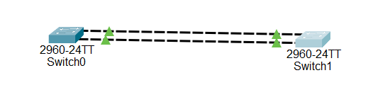

# EtherChannel Configuration (LACP)

**CCNA 200-301 Domain:** 2.0 Network Access (2.4 Configure and verify (Layer 2/Layer 3) EtherChannel (LACP))
**Tool:** Cisco Packet Tracer · **Completed:** August 15, 2026

## Objective

Bundle two parallel links between two switches into one logical link using **LACP**, so both cables carry traffic at the same time instead of spanning tree blocking one of them.

## Topology



| Device | Ports | Port-channel | LACP mode |
| --- | --- | --- | --- |
| Switch0 (2960) | Fa0/1, Fa0/2 | Po1 | **active** |
| Switch1 (2960) | Fa0/1, Fa0/2 | Po1 | **passive** |

Both bundles are access ports in **VLAN 10**.

## Why EtherChannel

Two cables between the same pair of switches form a loop. **Spanning tree** blocks one of them: you get redundancy but no extra bandwidth.

EtherChannel bundles the cables into one **logical interface** (a port-channel). Spanning tree sees a single link, so every member port forwards and traffic is load-balanced across them. If one cable fails, the bundle stays up on the rest.

## EtherChannel Types

| | **LACP** | **PAgP** | **Static** |
| --- | --- | --- | --- |
| Standard | IEEE 802.3ad, open | Cisco proprietary | none (no negotiation) |
| Modes | `active`, `passive` | `desirable`, `auto` | `on` |
| Active members | up to 8 (plus 8 standby, 16 configured) | up to 8 | up to 8 |

### Which mode combinations form a bundle

| Side A | Side B | Result |
| --- | --- | --- |
| active | active | ✅ bundle |
| active | passive | ✅ bundle (this lab) |
| passive | passive | ❌ neither side starts negotiation |
| desirable | desirable / auto | ✅ bundle (PAgP) |
| auto | auto | ❌ |
| on | on | ✅ bundle, no protocol |
| on | active / desirable | ❌ one side negotiates, the other doesn't |

`active` and `desirable` **start** negotiation; `passive` and `auto` only **respond**. At least one side has to start.

## Configuration

### Switch0

```
interface range fastEthernet 0/1 - 2
 switchport mode access
 switchport access vlan 10
 channel-group 1 mode active
```

### Switch1

```
interface range fastEthernet 0/1 - 2
 switchport mode access
 switchport access vlan 10
 channel-group 1 mode passive
```

`channel-group 1` creates **Port-channel1** automatically, and it inherits the member ports' settings:

```
interface Port-channel1
 switchport access vlan 10
 switchport mode access
```

Member ports must match on **speed, duplex, switchport mode, and VLAN** (access VLAN, or trunk allowed VLANs and native VLAN), or they won't join the bundle.

## Verification

Switch0's console as the bundle came up:

```
%LINK-5-CHANGED: Interface FastEthernet0/1, changed state to up
%LINEPROTO-5-UPDOWN: Line protocol on Interface FastEthernet0/1, changed state to up
%LINK-5-CHANGED: Interface FastEthernet0/2, changed state to up
%LINEPROTO-5-UPDOWN: Line protocol on Interface FastEthernet0/2, changed state to up
%LINK-5-CHANGED: Interface Port-channel1, changed state to up
%LINEPROTO-5-UPDOWN: Line protocol on Interface Port-channel1, changed state to up
```

The two physical ports came up first, then LACP negotiated with Switch1 and **Port-channel1** came up as one logical link.

`show etherchannel summary`, identical on both switches:

```
Flags:  D - down        P - in port-channel
        I - stand-alone s - suspended
        H - Hot-standby (LACP only)
        R - Layer3      S - Layer2
        U - in use      f - failed to allocate aggregator
        u - unsuitable for bundling
        w - waiting to be aggregated
        d - default port

Number of channel-groups in use: 1
Number of aggregators:           1

Group  Port-channel  Protocol    Ports
------+-------------+-----------+----------------------------------------------
1      Po1(SU)           LACP   Fa0/1(P) Fa0/2(P)
```

| Field | Value | Meaning |
| --- | --- | --- |
| Port-channel | `Po1(SU)` | **S** = Layer 2 bundle, **U** = in use |
| Protocol | `LACP` | negotiated with LACP, not PAgP or static `on` |
| Ports | `Fa0/1(P) Fa0/2(P)` | **P** = both members are bundled into Po1 |

Both switches report the same result, so the bundle formed from both ends. A failing member would show `I` (stand-alone) or `s` (suspended) instead of `P`.

Other commands:

- `show etherchannel port-channel`: the protocol (LACP) and member ports
- `show spanning-tree`: Po1 appears as a single interface instead of Fa0/1 and Fa0/2

## Key Takeaways

- EtherChannel turns parallel links into one logical link, so STP stops blocking the extras.
- LACP needs at least one side in **active** mode; passive–passive never forms.
- Configure the member ports identically, or the bundle won't form.
- **Improvement:** links between switches are usually **trunks**, so the bundle can carry every VLAN, not just VLAN 10:
  ```
  interface port-channel 1
   switchport mode trunk
  ```
  Both switches also share the default hostname `Switch`. Unique names (`hostname SW0`, `hostname SW1`) make logs and neighbor output easier to read.
