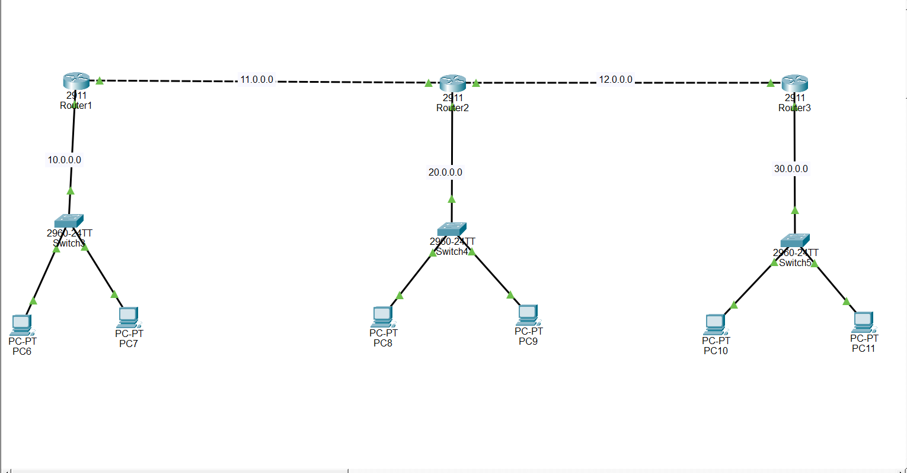

# RIP Configuration (Routing Information Protocol)

**CCNA 200-301 Domain:** 3.0 IP Connectivity (3.1 Routing table; 3.3 Routing protocol code, prefix, AD, metric)
**Tool:** Cisco Packet Tracer · **Completed:** June 28, 2026

## Objective

Connect three LANs across a chain of three routers using RIP, a distance-vector dynamic routing protocol, so that every PC can reach every other PC without static routes. Each router also serves DHCP to its own LAN.

## Topology



| Device | Interface | IP Address | Connects to |
| --- | --- | --- | --- |
| R1 (2911) | G0/0 | 10.0.0.1/8 | LAN 1 — Switch3, PC6, PC7 |
| R1 | G0/1 | 11.0.0.1/8 | R2 G0/0 |
| R2 (2911) | G0/0 | 11.0.0.2/8 | R1 G0/1 |
| R2 | G0/1 | 12.0.0.1/8 | R3 G0/0 |
| R2 | G0/2 | 20.0.0.1/8 | LAN 2 — Switch4, PC8, PC9 |
| R3 (2911) | G0/0 | 12.0.0.2/8 | R2 G0/1 |
| R3 | G0/1 | 30.0.0.1/8 | LAN 3 — Switch5, PC10, PC11 |

| Network | Purpose | DHCP pool / gateway |
| --- | --- | --- |
| 10.0.0.0/8 | LAN 1 | `r1` / 10.0.0.1 |
| 20.0.0.0/8 | LAN 2 | `r2` / 20.0.0.1 |
| 30.0.0.0/8 | LAN 3 | `r3` / 30.0.0.1 |
| 11.0.0.0/8 | R1–R2 link | — |
| 12.0.0.0/8 | R2–R3 link | — |

## RIP Overview

- **Type:** distance-vector — routers share their routing tables with direct neighbors (the Bellman-Ford algorithm)
- **Metric:** hop count (number of routers to the destination); lowest wins
- **Maximum:** 15 hops — a metric of 16 means unreachable
- **Administrative distance:** 120
- **Updates:** full table every 30 seconds — v1 broadcasts, v2 multicasts to 224.0.0.9

## Configuration

Each router advertises its directly connected networks (shown for R2, which touches three):

```
router rip
 network 11.0.0.0
 network 12.0.0.0
 network 20.0.0.0
```

| Router | `network` statements |
| --- | --- |
| R1 | 10.0.0.0, 11.0.0.0 |
| R2 | 11.0.0.0, 12.0.0.0, 20.0.0.0 |
| R3 | 12.0.0.0, 30.0.0.0 |

DHCP on each router (R1 shown):

```
ip dhcp pool r1
 network 10.0.0.0 255.0.0.0
 default-router 10.0.0.1
```

## Verification

- `show ip protocols` — RIP is running, networks advertised, neighbors (routing information sources), timers
- `show ip route rip` — routes learned from RIP, marked `R` with `[120/hops]`
- `ping` between PCs on different LANs (e.g. PC6 → PC11)

Expected routes learned on R1:

| Network | Via | Hops |
| --- | --- | --- |
| 12.0.0.0/8 | 11.0.0.2 | 1 |
| 20.0.0.0/8 | 11.0.0.2 | 1 |
| 30.0.0.0/8 | 11.0.0.2 | 2 |

## RIP Version 2 and Timers

The routers run the default (v1 sending). Version 2 carries subnet masks in its updates, so it supports VLSM and discontiguous networks:

```
router rip
 version 2
 no auto-summary
```

Timers (update, invalid, holddown, flush — defaults shown):

```
router rip
 timers basic 30 180 180 240
```

## Key Takeaways

- The `network` command is classful in RIP — it enables RIP on matching interfaces and advertises those networks.
- Hop count ignores bandwidth: a 2-hop path over slow links beats a 3-hop path over fast ones. That limitation is why OSPF (cost based on bandwidth) is preferred in larger networks.
- The 15-hop limit makes RIP suitable only for small networks.
- Each LAN uses public /8 address space; real deployments would use RFC 1918 ranges.
