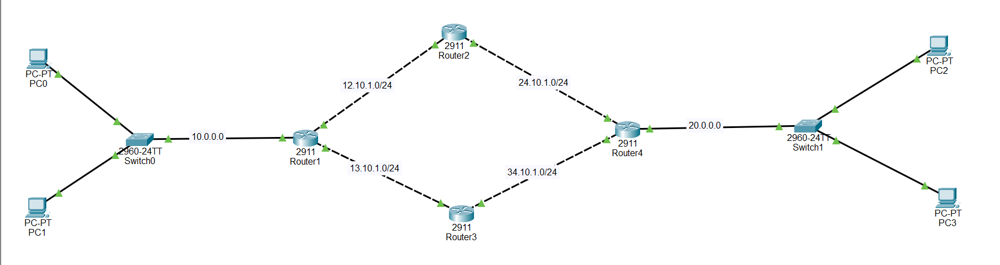

# EIGRP Configuration

**CCNA 200-301 Domain:** 3.0 IP Connectivity (3.1 Routing table; 3.3 Routing protocol code, prefix, AD, metric)
**Tool:** Cisco Packet Tracer · **Completed:** July 4, 2026

## Objective

Connect two LANs across four routers arranged in a diamond, using EIGRP in autonomous system 1. The design gives two equal-cost paths between the LANs, so EIGRP's load balancing and its successor/feasible-distance logic can be observed in the topology table.

## Topology



| Device | Interface | IP Address | Connects to |
| --- | --- | --- | --- |
| R1 (2911) | G0/0 | 10.0.0.1/8 | LAN 1 — Switch0, PC0, PC1 |
| R1 | G0/1 | 12.10.1.1/24 | R2 G0/0 |
| R1 | G0/2 | 13.10.1.1/24 | R3 G0/1 |
| R2 (2911) | G0/0 | 12.10.1.2/24 | R1 G0/1 |
| R2 | G0/1 | 24.10.1.1/24 | R4 G0/0 |
| R3 (2911) | G0/1 | 13.10.1.2/24 | R1 G0/2 |
| R3 | G0/0 | 34.10.1.1/24 | R4 G0/1 |
| R4 (2911) | G0/0 | 24.10.1.2/24 | R2 G0/1 |
| R4 | G0/1 | 34.10.1.2/24 | R3 G0/0 |
| R4 | G0/2 | 20.0.0.1/8 | LAN 2 — Switch1, PC2, PC3 |

LAN 1 and LAN 2 get addresses from DHCP pools on R1 (`r1`, gateway 10.0.0.1) and R4 (`r4`, gateway 20.0.0.1).

## EIGRP Overview

- **Type:** advanced distance-vector (often called "hybrid")
- **Algorithm:** DUAL (Diffusing Update Algorithm) — computes loop-free backup paths in advance
- **Autonomous system number:** 1–65535; neighbors only form when the AS numbers match
- **Metric:** composite, by default based on the slowest bandwidth and the total delay along the path
- **Administrative distance:** 90 internal, 170 external (redistributed)
- **Updates:** partial and only when something changes, sent to multicast **224.0.0.10**
- **Features:** classless (VLSM), summarization, authentication, unequal-cost load balancing (`variance`)

## Configuration

All four routers run `router eigrp 1` and advertise their connected networks with wildcard masks:

```
router eigrp 1
 network 10.0.0.0
 network 12.10.1.0 0.0.0.255
 network 13.10.1.0 0.0.0.255
```

| Router | `network` statements |
| --- | --- |
| R1 | 10.0.0.0, 12.10.1.0 0.0.0.255, 13.10.1.0 0.0.0.255 |
| R2 | 12.10.1.0 0.0.0.255, 24.10.1.0 0.0.0.255 |
| R3 | 13.10.1.0 0.0.0.255, 34.10.1.0 0.0.0.255 |
| R4 | 20.0.0.0, 24.10.1.0 0.0.0.255, 34.10.1.0 0.0.0.255 |

## Verification

Commands:

- `show ip protocols` — AS number, networks, neighbors, metric weights (K values)
- `show ip eigrp neighbors` — adjacencies with directly connected routers
- `show ip eigrp topology` — successors and feasible distances
- `show ip route eigrp` — EIGRP routes, marked `D` with `[90/metric]`

`show ip eigrp topology` on R1:

```
P 10.0.0.0/8, 1 successors, FD is 28160
         via Connected, GigabitEthernet0/0
P 12.10.1.0/24, 1 successors, FD is 2816
         via Connected, GigabitEthernet0/1
P 13.10.1.0/24, 1 successors, FD is 2816
         via Connected, GigabitEthernet0/2
P 20.0.0.0/8, 2 successors, FD is 28672
         via 13.10.1.2 (28672/28416), GigabitEthernet0/2
         via 12.10.1.2 (28672/28416), GigabitEthernet0/1
P 24.10.1.0/24, 1 successors, FD is 3072
         via 12.10.1.2 (3072/2816), GigabitEthernet0/1
P 34.10.1.0/24, 1 successors, FD is 3072
         via 13.10.1.2 (3072/2816), GigabitEthernet0/2
```

### Reading the output

- **`P`** — passive: the route is stable.
- **`(28672/28416)`** — feasible distance / reported distance. **FD** is R1's total metric to the network; **RD** is the neighbor's own metric to it.
- **`20.0.0.0/8, 2 successors`** — the paths through R2 and R3 cost exactly the same (28672), so EIGRP installs both and **load-balances** across the diamond.
- **Why 2816 vs 28160:** EIGRP's metric is `256 × (10^7 / slowest bandwidth in kbps + total delay / 10)`. A Gigabit router-to-router link gives 256 × (10 + 1) = **2816**. The LAN links connect to FastEthernet switch ports (100 Mbps, 100 µs delay), giving 256 × (100 + 10) = **28160**. To LAN 2, the slowest link is 100 Mbps and the delay adds up to 120 µs, giving 256 × (100 + 12) = **28672**.

## Key Takeaways

- Neighbors form only when the **AS number** (and K values) match on both sides.
- Wildcard masks in `network` statements (`0.0.0.255`) select interfaces precisely, instead of the classful matching RIP uses.
- Equal-cost paths are load-balanced automatically. `variance` extends this to unequal-cost paths, as long as they meet the feasibility condition (RD < FD of the successor).
- Unlike RIP, EIGRP's metric reflects bandwidth and delay, and it reconverges fast because DUAL keeps backup routes ready.
