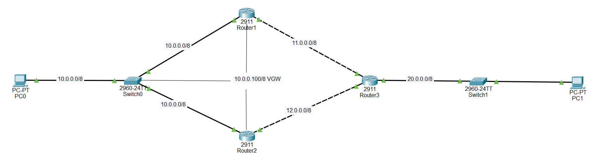

# HSRP Configuration (Hot Standby Router Protocol)

**CCNA 200-301 Domain:** 3.0 IP Connectivity (3.5 Describe the purpose, functions, and concepts of first hop redundancy protocols)
**Tool:** Cisco Packet Tracer · **Completed:** August 6, 2026

## Objective

Remove the default gateway as a single point of failure. Two routers on the same LAN share one **virtual IP**, which the hosts use as their gateway. One router actively forwards; the other stands by and takes over the same virtual IP and MAC if the active router fails, with no change on the hosts.

## Topology



| Device | Interface | IP Address | Connects to |
| --- | --- | --- | --- |
| R1 (2911) | G0/0 | 10.0.0.1/8 | LAN 1 (Switch0, PC0), HSRP group 1 |
| R1 | G0/1 | 11.0.0.1/8 | R3 |
| R2 (2911) | G0/0 | 10.0.0.2/8 | LAN 1 (Switch0, PC0), HSRP group 1 |
| R2 | G0/1 | 12.0.0.1/8 | R3 |
| R3 (2911) | G0/0 | 11.0.0.2/8 | R1 |
| R3 | G0/1 | 12.0.0.2/8 | R2 |
| R3 | G0/2 | 20.0.0.1/8 | LAN 2 (Switch1, PC1) |
| **Virtual gateway (VGW)** | — | **10.0.0.100/8** | shared by R1 and R2 |

PC0 uses **10.0.0.100** as its default gateway, never the real router addresses. All three routers run **EIGRP AS 1**, so LAN 2 can be reached through either R1 or R2.

## HSRP Overview

| Term | Meaning |
| --- | --- |
| **Active** router | Answers ARP for the virtual IP and forwards the LAN's traffic |
| **Standby** router | Monitors the active router; takes over if it stops hearing hellos |
| **Virtual IP** | The gateway address hosts use (10.0.0.100), not tied to one physical router |
| **Virtual MAC** | `0000.0c07.acXX`, where XX is the group number in hex (group 1 → `0000.0c07.ac01`) |
| **Priority** | 0–255, default **100**; highest wins the active role. On a tie, the highest interface IP wins |
| **Preempt** | Lets a router with a **higher priority** take the active role from the current active router. **Off by default** |

- Cisco proprietary. Hellos every **3 s**, hold time **10 s**
- Version 1 uses multicast **224.0.0.2**, UDP port **1985**
- Similar protocols: **VRRP** (open standard) and **GLBP** (Cisco, load-balances across routers)

## Configuration

### R1 and R2 (LAN-facing interface)

```
interface gigabitEthernet 0/0
 standby 1 ip 10.0.0.100
```

Both routers use **group 1** and the same virtual IP. The lab started with no priority or preempt, so both used the default priority of 100.

Final configuration on R2, after the troubleshooting below:

```
interface gigabitEthernet 0/0
 standby 1 ip 10.0.0.100
 standby 1 priority 110
 standby 1 preempt
```

### Routing (EIGRP AS 1)

```
R1: network 10.0.0.0
    network 11.0.0.0
R2: network 10.0.0.0
    network 12.0.0.0
R3: network 11.0.0.0
    network 12.0.0.0
    network 20.0.0.0
```

## Verification

HSRP state changes logged on R2 as it came up:

```
%HSRP-6-STATECHANGE: GigabitEthernet0/0 Grp 1 state Speak -> Standby
%HSRP-6-STATECHANGE: GigabitEthernet0/0 Grp 1 state Standby -> Active
```

R2 moved through the HSRP states (Init → Listen → **Speak** → **Standby** → **Active**) and won the active role. With both routers at the default priority of 100, the tie goes to the **highest interface IP**: R2's 10.0.0.2 beats R1's 10.0.0.1.

`show standby brief` on R2:

```
                     P indicates configured to preempt.
                     |
Interface   Grp  Pri P State    Active          Standby         Virtual IP
Gig0/0      1    100   Active   local           10.0.0.1        10.0.0.100
```

| Column | Value | Meaning |
| --- | --- | --- |
| Grp | 1 | HSRP group 1 |
| Pri | 100 | default priority |
| P | (blank) | preempt is **not** configured |
| State | Active | R2 is forwarding for the virtual IP |
| Active | local | this router (R2) is the active router |
| Standby | 10.0.0.1 | R1 is ready to take over |
| Virtual IP | 10.0.0.100 | the gateway PC0 uses |

`show standby brief` on R1, the same group seen from the other side:

```
Interface   Grp  Pri P State    Active          Standby         Virtual IP
Gig0/0      1    100   Standby  10.0.0.2        local           10.0.0.100
```

R1 reports itself (`local`) as **Standby** and names R2 (10.0.0.2) as Active. Both routers agree on the roles and the virtual IP, which confirms the election: equal priorities, so R2 won on its higher IP.

Other commands:
- `show standby`: full detail, including the virtual MAC and hello/hold timers
- From PC0, `ping 20.0.0.x` (PC1) and `arp -a`: the gateway 10.0.0.100 should map to `0000.0c07.ac01`

### Failover test

With R2 active and R1 standby, R2's LAN interface (G0/0) was shut down. R1's console:

```
r1#show standby brief
Interface   Grp  Pri P State    Active          Standby         Virtual IP
Gig0/0      1    100   Standby  10.0.0.2        local           10.0.0.100

%HSRP-6-STATECHANGE: GigabitEthernet0/0 Grp 1 state Standby -> Active
%DUAL-5-NBRCHANGE: IP-EIGRP 1: Neighbor 10.0.0.2 (GigabitEthernet0/0) is down: holding time expired
```

- R1 stopped hearing R2's HSRP hellos, waited out the **hold time (10 s)**, and promoted itself from **Standby to Active**. It now answers for 10.0.0.100 and its virtual MAC, so PC0 keeps the same gateway with no change.
- The HSRP takeover is logged **before** EIGRP notices R2 is gone. EIGRP's hold time on LAN links is **15 s**, so the gateway was already back before routing finished reacting.

To repeat the test with traffic: run `ping -t` from PC0 to PC1, shut the active router's G0/0, and watch the ping drop for a few seconds and then recover. `no shutdown` brings R2 back as **standby**, not active, because preempt is not configured.

## Troubleshooting: Getting R2 to Take Back the Active Role

After the failover test, R2 came back up as **standby**, with R1 still active. Getting R2 to reclaim the active role took three steps.

**1. Preempt on the wrong group.** The first attempt used `standby preempt` with no group number:

```
interface GigabitEthernet0/0
 standby 1 ip 10.0.0.100
 standby preempt
```

Without a number, HSRP applies the command to **group 0**, but the virtual IP lives in **group 1**. `show standby brief` still showed an empty `P` column for group 1. Fix:

```
no standby preempt
standby 1 preempt
```

**2. Preempt on, but still standby.** Now group 1 showed `P`, but R2 stayed standby:

```
Interface   Grp  Pri P State    Active          Standby         Virtual IP
Gig0/0      1    100 P Standby  10.0.0.1        local           10.0.0.100
```

Preempt only takes over from an active router with a **lower priority**. Both were at 100, so R2 had nothing to win with. The highest-IP tiebreaker only decides the initial election; it never displaces a router that is already active.

**3. Raise the priority.**

```
standby 1 priority 110
```

R2 immediately took over:

```
Interface   Grp  Pri P State    Active          Standby         Virtual IP
Gig0/0      1    110 P Active   local           10.0.0.1        10.0.0.100
```

R2 is now the intended active router: priority 110 beats R1's 100, and preempt means it will reclaim the role every time it recovers from a failure.

## Key Takeaways

- Hosts only know the virtual IP, so a router failure needs no change on any PC.
- Without `priority`, the highest IP wins the first election. Without `preempt`, the active role does not move back after a failover.
- `preempt` only acts on a **higher priority**, so pair it with `standby <group> priority`.
- Every `standby` command needs the group number. A bare `standby preempt` silently configures group 0.
- All routers in a group must share the same group number and virtual IP, on the same LAN segment.
- HSRP gives redundancy, not load balancing: only one router forwards for the group at a time.
