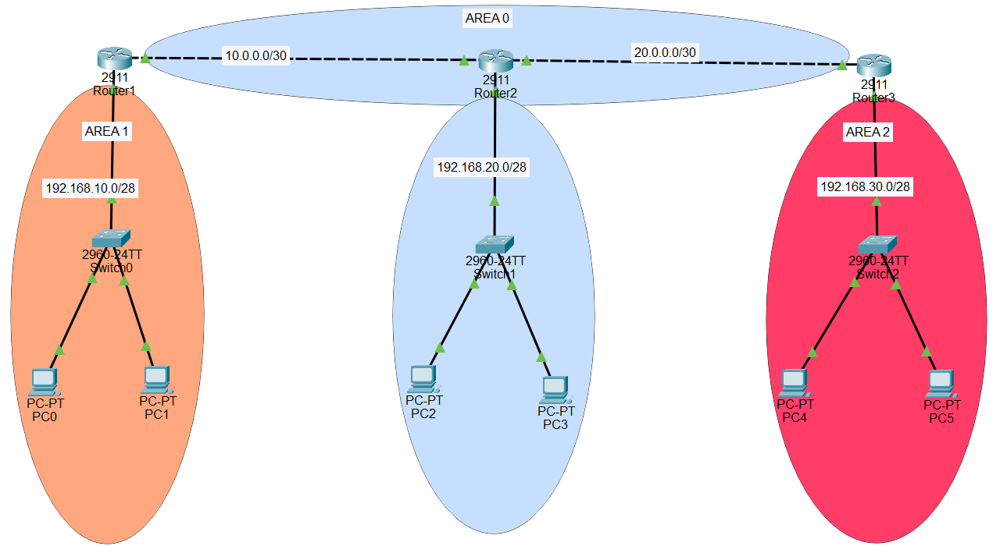

# OSPF Configuration (Multi-Area)

**CCNA 200-301 Domain:** 3.0 IP Connectivity (3.4 Configure and verify single area OSPFv2, extended here to multiple areas; 3.3 Routing protocol code, prefix, AD, metric)
**Tool:** Cisco Packet Tracer · **Completed:** August 11, 2026

## Objective

Connect three LANs with OSPF, split into three areas around a backbone. R2 sits entirely in the backbone (area 0), while R1 and R3 each join the backbone to their own LAN area. This shows how areas limit LSA flooding and how routes travel between areas.

## Topology



| Device | Router ID | Interface | IP Address | OSPF area |
| --- | --- | --- | --- | --- |
| R1 (2911) | 1.1.1.1 | G0/0 | 192.168.10.1/28 | **1**: LAN 1 (PC0, PC1) |
| R1 | | G0/1 | 10.0.0.1/30 | **0**: link to R2 |
| R2 (2911) | 2.2.2.2 | G0/0 | 10.0.0.2/30 | **0**: link to R1 |
| R2 | | G0/1 | 192.168.20.1/28 | **0**: LAN 2 (PC2, PC3) |
| R2 | | G0/2 | 20.0.0.1/30 | **0**: link to R3 |
| R3 (2911) | 3.3.3.3 | G0/0 | 20.0.0.2/30 | **0**: link to R2 |
| R3 | | G0/1 | 192.168.30.1/28 | **2**: LAN 3 (PC4, PC5) |

Each LAN gets addresses from its router's DHCP pool. Router-to-router links use **/30** subnets (2 usable addresses, the minimum for a point-to-point link), and LANs use **/28** (14 usable hosts).

### Router roles

| Router | Role | Why |
| --- | --- | --- |
| R1 | **ABR** (Area Border Router) | interfaces in area 0 and area 1 |
| R2 | **Backbone router** | every interface in area 0 |
| R3 | **ABR** | interfaces in area 0 and area 2 |

## OSPF Overview

- **Link-state** protocol: every router builds a full map of its area (the **LSDB**) from **LSAs** (Link State Advertisements), then runs **SPF / Dijkstra** to find the shortest paths
- **Classless**: masks travel in every update, so VLSM works (this lab mixes /30 and /28)
- **Administrative distance:** 110
- **Metric:** cost = reference bandwidth (100 Mbps by default) ÷ interface bandwidth. Every FastEthernet and GigabitEthernet link costs **1** with the default reference
- **Multicast:** **224.0.0.5** to all OSPF routers, **224.0.0.6** to the DR and BDR
- **Areas** keep each LSDB small. All areas must connect to **area 0**, the backbone. ABRs summarize one area's networks into the others as Type 3 LSAs

### Neighbor states

Routers pass through these states before they exchange routes:

**Down → (Attempt) → Init → 2-Way → ExStart → Exchange → Loading → Full**

*Attempt* only appears on NBMA networks with manually configured neighbors. **Full** means the LSDBs are synchronized:

```
%OSPF-5-ADJCHG: Process 1, Nbr 2.2.2.2 on GigabitEthernet0/1 from LOADING to FULL, Loading Done
```

That is R1 (via G0/1) completing its adjacency with R2, identified by R2's router ID, 2.2.2.2.

### DR and BDR

On **multi-access** segments such as Ethernet, routers elect a **Designated Router** and a **Backup DR**, so each router forms a full adjacency with only those two instead of with every other router:

- Election goes to the highest **interface priority** (default 1), then the highest **router ID**
- The election is per **segment**, not per area, and it is **not preemptive**: a better router joining later does not take over until the DR fails
- Other routers (DROTHERs) send updates to the DR and BDR on 224.0.0.6, and the DR re-floods them to everyone on 224.0.0.5
- Ethernet links count as multi-access even when only two routers are on them, as on this lab's /30 links. `ip ospf network point-to-point` on those interfaces skips the election

## Configuration

```
R1:
router ospf 1
 router-id 1.1.1.1
 network 192.168.10.0 0.0.0.15 area 1
 network 10.0.0.0 0.0.0.3 area 0

R2:
router ospf 1
 router-id 2.2.2.2
 network 10.0.0.0 0.0.0.3 area 0
 network 192.168.20.0 0.0.0.15 area 0
 network 20.0.0.0 0.0.0.3 area 0

R3:
router ospf 1
 router-id 3.3.3.3
 network 192.168.30.0 0.0.0.15 area 2
 network 20.0.0.0 0.0.0.3 area 0
```

| Part | Meaning |
| --- | --- |
| `router ospf 1` | process ID 1–65535. It is local to the router and does not have to match neighbors |
| `router-id 1.1.1.1` | the router's OSPF name: fixed and predictable instead of auto-picked from an IP |
| `network … 0.0.0.15` | wildcard for /28 (255.255.255.240) |
| `network … 0.0.0.3` | wildcard for /30 (255.255.255.252) |
| `area 0` / `area 1` / `area 2` | which area the matching interfaces join. Both ends of a link must agree |

## Verification

- `show ip ospf neighbor`: neighbors, their router IDs and states. **FULL** on every link
- `show ip route ospf`: OSPF routes, marked `O` (same area) or `O IA` (inter-area)
- `show ip ospf database`: the LSDB, including Type 3 summary LSAs from the ABRs
- `show ip protocols`: router ID, networks, areas
- `show run | section ospf`: the OSPF configuration only
- Ping from PC0 (area 1) to PC5 (area 2): crosses both ABRs and the backbone

### `show ip route ospf` on R1

```
     20.0.0.0/30 is subnetted, 1 subnets
O       20.0.0.0 [110/2] via 10.0.0.2, 00:05:23, GigabitEthernet0/1
     192.168.20.0/28 is subnetted, 1 subnets
O       192.168.20.0 [110/2] via 10.0.0.2, 00:05:23, GigabitEthernet0/1
     192.168.30.0/28 is subnetted, 1 subnets
O IA    192.168.30.0 [110/3] via 10.0.0.2, 00:05:23, GigabitEthernet0/1
```

| Route | Code | `[AD/cost]` | Why |
| --- | --- | --- | --- |
| 20.0.0.0/30 | `O` | 110/2 | R2–R3 link, area 0. Cost 1 (R1 G0/1) + 1 (R2 G0/2) |
| 192.168.20.0/28 | `O` | 110/2 | R2's LAN, area 0 |
| 192.168.30.0/28 | **`O IA`** | 110/3 | LAN 3 sits in **area 2**, so R3 (the ABR) summarizes it into area 0 as an inter-area route. Three links at cost 1 each |

Every route goes via 10.0.0.2 (R2), R1's only OSPF neighbor. The **`O IA`** entry is the proof that multi-area routing is working.

### `show ip ospf neighbor` on R2

```
Neighbor ID     Pri   State           Dead Time   Address         Interface
1.1.1.1           1   FULL/BDR        00:00:36    10.0.0.1        GigabitEthernet0/0
3.3.3.3           1   FULL/DR         00:00:36    20.0.0.2        GigabitEthernet0/2
```

- Both adjacencies are **FULL**: the LSDBs are synchronized.
- **A separate DR/BDR election ran on each /30 link**, because Ethernet is multi-access even with only two routers:
  - **R1–R2 link:** R1 (1.1.1.1) is the **BDR**, so R2 (2.2.2.2) is the DR
  - **R2–R3 link:** R3 (3.3.3.3) is the **DR**, so R2 is the BDR there
- With every priority at the default of 1, the **higher router ID wins** each election. R2 is DR on one link and BDR on the other, which shows the election really is per segment.
- **Dead Time** counts down from 40 seconds (four 10-second hellos) and resets each time a hello arrives.

## Key Takeaways

- Every non-backbone area must touch area 0. Here, R1 and R3 are the ABRs that connect areas 1 and 2 to it.
- Set router IDs manually so neighbor tables and logs are easy to read (1.1.1.1, 2.2.2.2, 3.3.3.3).
- The process ID is local, but **area IDs, subnet masks and hello/dead timers** must match for neighbors to form.
- `O IA` routes in the table are the visible proof that the areas are working.
