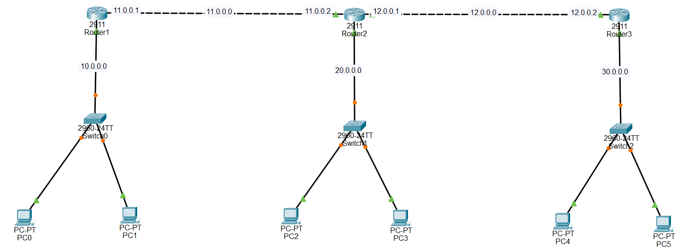

# Static Routing (3 Sites)

**CCNA 200-301 Domain:** 3.0 IP Connectivity (3.3 Configure and verify IPv4 and IPv6 static routing)
**Tool:** Cisco Packet Tracer · **Completed:** August 13, 2026

## Objective

Connect three LANs across a chain of three routers using only **manually configured static routes**, with no routing protocol. Each router is told exactly which next hop leads to every network it isn't directly connected to.

## Topology



| Device | Interface | IP Address | Connects to |
| --- | --- | --- | --- |
| R1 (2911) | G0/0 | 10.0.0.1/8 | LAN 1 (PC0, PC1) |
| R1 | G0/1 | 11.0.0.1/8 | R2 |
| R2 (2911) | G0/0 | 11.0.0.2/8 | R1 |
| R2 | G0/1 | 12.0.0.1/8 | R3 |
| R2 | G0/2 | 20.0.0.1/8 | LAN 2 (PC2, PC3) |
| R3 (2911) | G0/0 | 12.0.0.2/8 | R2 |
| R3 | G0/1 | 30.0.0.1/8 | LAN 3 (PC4, PC5) |

Each LAN gets addresses from its router's DHCP pool, with the router's LAN address as the default gateway.

## Static Routing Overview

- Routes are typed in by an administrator: `ip route <destination network> <mask> <next hop>`
- The **next hop** is the IP address of the neighboring router's interface on the shared link
- **Administrative distance 1**, so a static route beats any dynamic protocol (OSPF 110, EIGRP 90, RIP 120)
- No routing updates, so no CPU or bandwidth overhead, and the routes are predictable
- No automatic failover: if a link goes down, the route stays until someone changes it
- Every router needs a route to every remote network, **in both directions**, or replies can't get back

## Configuration

### Static routes

| Router | Destination | Next hop | Why |
| --- | --- | --- | --- |
| R1 | 20.0.0.0/8 | 11.0.0.2 (R2) | LAN 2 is behind R2 |
| R1 | 30.0.0.0/8 | 11.0.0.2 (R2) | LAN 3 is also reached through R2 |
| R2 | 10.0.0.0/8 | 11.0.0.1 (R1) | LAN 1 is behind R1 |
| R2 | 30.0.0.0/8 | 12.0.0.2 (R3) | LAN 3 is behind R3 |
| R3 | 10.0.0.0/8 | 12.0.0.1 (R2) | LAN 1 is reached through R2 |
| R3 | 20.0.0.0/8 | 12.0.0.1 (R2) | LAN 2 is behind R2 |

```
R1:
ip route 20.0.0.0 255.0.0.0 11.0.0.2
ip route 30.0.0.0 255.0.0.0 11.0.0.2

R2:
ip route 10.0.0.0 255.0.0.0 11.0.0.1
ip route 30.0.0.0 255.0.0.0 12.0.0.2

R3:
ip route 10.0.0.0 255.0.0.0 12.0.0.1
ip route 20.0.0.0 255.0.0.0 12.0.0.1
```

R1 and R3 don't need routes to the 11.0.0.0 and 12.0.0.0 link networks, because the PCs only talk to each other's LANs.

### DHCP (R2 shown)

```
ip dhcp excluded-address 20.0.0.1
ip dhcp pool r2
 network 20.0.0.0 255.0.0.0
 default-router 20.0.0.1
```

## Verification

### `show ip route` on R1

```
Gateway of last resort is not set

     10.0.0.0/8 is variably subnetted, 2 subnets, 2 masks
C       10.0.0.0/8 is directly connected, GigabitEthernet0/0
L       10.0.0.1/32 is directly connected, GigabitEthernet0/0
     11.0.0.0/8 is variably subnetted, 2 subnets, 2 masks
C       11.0.0.0/8 is directly connected, GigabitEthernet0/1
L       11.0.0.1/32 is directly connected, GigabitEthernet0/1
S    20.0.0.0/8 [1/0] via 11.0.0.2
S    30.0.0.0/8 [1/0] via 11.0.0.2
```

| Code | Entry | Meaning |
| --- | --- | --- |
| `C` | 10.0.0.0/8, 11.0.0.0/8 | networks on R1's own interfaces |
| `L` | 10.0.0.1/32, 11.0.0.1/32 | R1's own interface addresses (host routes) |
| `S` | 20.0.0.0/8, 30.0.0.0/8 | the static routes: `[1/0]` = AD 1, metric 0, both through R2 at 11.0.0.2 |

- **"Gateway of last resort is not set"**: there is no default route, so a packet for any network not in this table is dropped. With the default-route improvement below, this line would show 11.0.0.2.
- There is **no route to 12.0.0.0** (the R2–R3 link). R1 can't ping R3's 12.0.0.2 address, but the LANs can still reach each other, which is all this lab needs.

Other checks:

- `show ip route static`: routes marked `S` with `[1/0]` (AD 1, metric 0)
- `show ip route`: static routes alongside the directly connected (`C`) and local (`L`) networks
- Ping from PC0 (LAN 1) to PC2 (LAN 2) and PC4 (LAN 3)
- `tracert` from PC0 to a LAN 3 address: shows each router hop (10.0.0.1 → 11.0.0.2 → 12.0.0.2)

## Troubleshooting: DHCP Exclusions Missing on R1 and R3

The build notes include an exclusion on every router, but only **R2's** running config has one:

```
R2: ip dhcp excluded-address 20.0.0.1    ← present
R1: (none)
R3: (none)
```

Two mistakes in the notes explain it:

- R1's line was typed as `ip dhpc excluded-address`, so IOS rejected it as an invalid command.
- On R1 and R3 the exclusion was entered **inside** the pool (before `exit`). `ip dhcp excluded-address` is a **global configuration** command; in the pool's `dhcp-config` mode it isn't recognized.

Fix, from global config:

```
R1(config)# ip dhcp excluded-address 10.0.0.1
R3(config)# ip dhcp excluded-address 30.0.0.1
```

Without it, the router's DHCP ping check finds its own gateway address in use and logs a `%DHCPD-4-PING_CONFLICT` message, as seen in the [NTP & Syslog lab](../../04-ip-services/06-ntp-syslog/).

**Status: fixed.** Both exclusions were added from global configuration, so all three routers now keep their gateway address out of the pool.

## Improvement: Default Routes on the Edge Routers

R1 and R3 are **stub** routers: everything they don't know about goes through R2. A single default route replaces both of their static routes and keeps working when new sites are added:

```
R1: ip route 0.0.0.0 0.0.0.0 11.0.0.2
R3: ip route 0.0.0.0 0.0.0.0 12.0.0.1
```

R2 still needs specific routes, because it sits in the middle and must choose between R1 and R3.

## Key Takeaways

- Static routes are simple and predictable, but every change, new network or failed link means editing routes by hand.
- Routes are needed on **both** paths: forward to the destination and back to the source.
- A default route (`0.0.0.0 0.0.0.0`) is the cleanest option for a router with only one way out.
- Static routing works well for small networks. Beyond a few sites, a dynamic protocol such as OSPF or EIGRP is easier to maintain.
