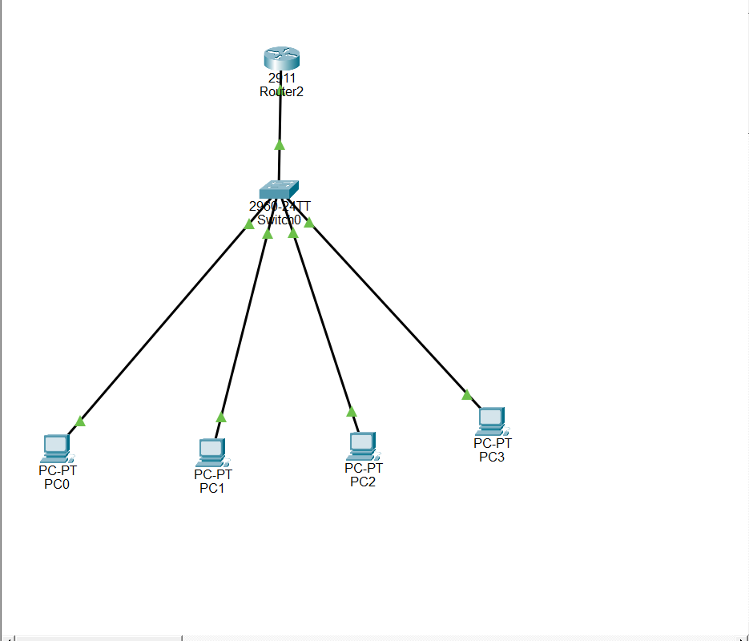

# DHCP Configuration on a Router

**CCNA 200-301 Domain:** 4.0 IP Services (4.3 DHCP client and relay; 4.6 DHCP configuration)
**Tool:** Cisco Packet Tracer · **Completed:** June 27, 2026

## Objective

Configure a Cisco router as a DHCP server so that hosts on the LAN receive their IP address and default gateway automatically, with the gateway address excluded from the pool.

## Topology



| Device | Model | Interface | IP Address | Notes |
| --- | --- | --- | --- | --- |
| R1 | Cisco 2911 (IOS 15.1) | G0/0 | 11.0.0.1/8 | Default gateway, DHCP server |
| Switch0 | Cisco 2960-24TT | — | — | Access switch |
| PC0–PC3 | PC-PT | NIC | DHCP | 11.0.0.0/8 pool |

## Configuration

```
enable
configure terminal
hostname R1
interface gigabitEthernet 0/0
 ip address 11.0.0.1 255.0.0.0
 no shutdown
 exit
ip dhcp excluded-address 11.0.0.1
ip dhcp pool R1
 network 11.0.0.0 255.0.0.0
 default-router 11.0.0.1
 exit
```

On each PC: **Desktop → IP Configuration → DHCP**.

## Verification

`show running-config` on R1:

```
hostname R1
ip dhcp excluded-address 11.0.0.1
ip dhcp pool R1
 network 11.0.0.0 255.0.0.0
 default-router 11.0.0.1
interface GigabitEthernet0/0
 ip address 11.0.0.1 255.0.0.0
```

Each PC received an address from the 11.0.0.0/8 pool with 11.0.0.1 as its gateway. Further checks:

- `show ip dhcp binding` on R1 — lists each leased IP and client MAC
- `ipconfig` on a PC — shows the leased address and gateway

## Key Takeaways

- `ip dhcp excluded-address` is a **global configuration** command, entered outside the pool, and reserves addresses (gateway, servers, printers) from being leased.
- A pool needs `network` and `default-router` at minimum; `dns-server` is optional but hosts need it for name resolution.
- 11.0.0.0/8 is public address space. Real LANs use RFC 1918 private ranges (10.0.0.0/8, 172.16.0.0/12, 192.168.0.0/16).
