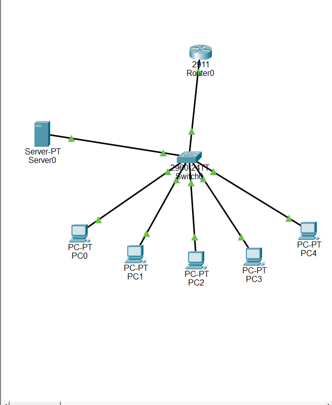

# DHCP Configuration on a Server

**CCNA 200-301 Domain:** 4.0 IP Services (4.3 DHCP client and relay; 4.6 DHCP configuration)
**Tool:** Cisco Packet Tracer · **Completed:** June 27, 2026

## Objective

Use a dedicated server, instead of the router, to hand out IP addresses to LAN hosts in a /28 subnet, with the router acting as default gateway.

## Topology



| Device | Model | Interface | IP Address | Notes |
| --- | --- | --- | --- | --- |
| R1 | Cisco 2911 (IOS 15.1) | G0/0 | 192.168.10.1/28 | Default gateway |
| Server0 | Server-PT | NIC | 192.168.10.2/28 (static) | DHCP service |
| Switch0 | Cisco 2960-24TT | — | — | Access switch |
| PC0–PC4 | PC-PT | NIC | DHCP | 192.168.10.0/28 |

**Subnet:** 192.168.10.0/28 (255.255.255.240) — usable hosts .1–.14, broadcast .15.

## Configuration

### Step 1 — Router

```
enable
configure terminal
hostname R1
interface gigabitEthernet 0/0
 ip address 192.168.10.1 255.255.255.240
 no shutdown
 exit
do write
```

### Step 2 — Server static IP

**Server0 → Desktop → IP Configuration (Static):**
IP 192.168.10.2 · Mask 255.255.255.240 · Gateway 192.168.10.1

### Step 3 — Server DHCP service

**Server0 → Services → DHCP:** Service **On**, Default Gateway 192.168.10.1, Subnet Mask 255.255.255.240 → **Save**. Recommended: set Start IP to 192.168.10.3 so the pool skips the router and server.

### Step 4 — Clients

On each PC: **Desktop → IP Configuration → DHCP**.

## Verification

`show running-config` on R1:

```
hostname R1
interface GigabitEthernet0/0
 ip address 192.168.10.1 255.255.255.240
```

R1 runs no DHCP pool of its own — all leases come from Server0. Each PC received an address in 192.168.10.0/28 with gateway 192.168.10.1.

## Key Takeaways

- A /28 gives only **14 usable hosts**. With the router (.1) and server (.2) using static addresses, the pool should start at .3 so it never leases an address already in use.
- The server works here because it is in the **same broadcast domain** as the clients. DHCP Discover is a broadcast, so a server on another subnet requires `ip helper-address <server-ip>` on the router interface facing the clients (DHCP relay).
- Router-based DHCP suits small sites; a central server scales better across many subnets.
