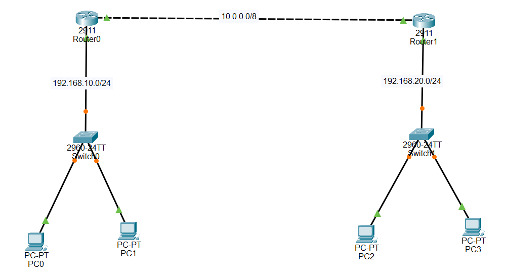

# Static NAT Configuration

**CCNA 200-301 Domain:** 4.0 IP Services (4.1 Configure and verify inside source NAT using static and pools)
**Tool:** Cisco Packet Tracer · **Completed:** July 8, 2026

## Objective

Give one host on each private LAN a permanent public identity using static NAT, so the two sites can reach those hosts across a shared "public" link without either router knowing the other's private network.

## Topology



| Device | Interface | IP Address | NAT role |
| --- | --- | --- | --- |
| R1 (2911) | G0/0 | 192.168.10.1/24 | inside — LAN 1 (2960 switch, PC0, PC1) |
| R1 | G0/1 | 10.0.0.1/8 | outside — link to R2 |
| R2 (2911) | G0/0 | 192.168.20.1/24 | inside — LAN 2 (2960 switch, PC2, PC3) |
| R2 | G0/1 | 10.0.0.2/8 | outside — link to R1 |

Each LAN gets addresses from its router's DHCP pool (gateway .1 excluded from the pool).

### NAT mappings

| Router | Host | Inside local (private) | Inside global (public) |
| --- | --- | --- | --- |
| R1 | PC0 | 192.168.10.2 | 10.0.0.20 |
| R2 | PC2 | 192.168.20.2 | 10.0.0.26 |

## NAT Terminology

- **Inside local** — the host's real, private address (192.168.10.2)
- **Inside global** — the public address that represents it to the outside (10.0.0.20)
- **Outside local / outside global** — the remote host's address as seen from inside / its real address (identical here, since only inside addresses are translated)

## Configuration

### R1

```
interface gigabitEthernet 0/0
 ip address 192.168.10.1 255.255.255.0
 ip nat inside
interface gigabitEthernet 0/1
 ip address 10.0.0.1 255.0.0.0
 ip nat outside
 exit
ip nat inside source static 192.168.10.2 10.0.0.20
ip route 0.0.0.0 0.0.0.0 10.0.0.2
```

### R2

```
interface gigabitEthernet 0/0
 ip address 192.168.20.1 255.255.255.0
 ip nat inside
interface gigabitEthernet 0/1
 ip address 10.0.0.2 255.0.0.0
 ip nat outside
 exit
ip nat inside source static 192.168.20.2 10.0.0.26
ip route 0.0.0.0 0.0.0.0 10.0.0.1
```

DHCP on each router (R1 shown):

```
ip dhcp excluded-address 192.168.10.1
ip dhcp pool r1
 network 192.168.10.0 255.255.255.0
 default-router 192.168.10.1
```

## Verification

`show ip nat translations` on R1:

```
Pro  Inside global     Inside local       Outside local      Outside global
---  10.0.0.20         192.168.10.2       ---                ---
```

The `---` protocol entry is the permanent static mapping — it exists before any traffic flows. To test end to end, ping PC2's public address from PC0:

```
ping 10.0.0.26
```

`show ip nat translations` on R2 after a ping from LAN 1 to 10.0.0.26:

```
Pro  Inside global     Inside local       Outside local      Outside global
icmp 10.0.0.26:3       192.168.20.2:3     192.168.10.3:3     192.168.10.3:3
icmp 10.0.0.26:4       192.168.20.2:4     192.168.10.3:4     192.168.10.3:4
icmp 10.0.0.26:5       192.168.20.2:5     192.168.10.3:5     192.168.10.3:5
icmp 10.0.0.26:6       192.168.20.2:6     192.168.10.3:6     192.168.10.3:6
icmp 10.0.0.26:7       192.168.20.2:7     192.168.10.3:7     192.168.10.3:7
icmp 10.0.0.26:8       192.168.20.2:8     192.168.10.3:8     192.168.10.3:8
---  10.0.0.26         192.168.20.2       ---                ---
```

Each `icmp` line is one echo request: R2 translated the destination 10.0.0.26 to PC2's real address 192.168.20.2, and the reply went back out as 10.0.0.26. The number after the colon is the ICMP identifier, which keeps each exchange separate.

The sender shows up as **192.168.10.3**, not as 10.0.0.20. R1 only translates 192.168.10.2, so traffic from any other LAN 1 address leaves R1 untranslated. The reply still gets home because R2's default route sends 192.168.10.x back to R1 — in a real network, a private source address like this would be dropped on the internet.

## Key Takeaways

- Static NAT is **one-to-one and permanent**: it also lets outside hosts start connections *in* to the inside host (useful for servers).
- Every NAT setup needs three parts: `ip nat inside`, `ip nat outside`, and a translation rule.
- The default routes point each router at the other's outside address — the only addresses the routers need to know.
- **Watch out:** the mapped hosts get their addresses from DHCP. If PC0 leases a different address, the static rule no longer matches it and its traffic leaves untranslated — exactly what the 192.168.10.3 source above looks like. Hosts behind static NAT should use a static IP or a DHCP reservation.
- Static NAT does not scale — one public address per host. Dynamic NAT and PAT (overload) solve that.
