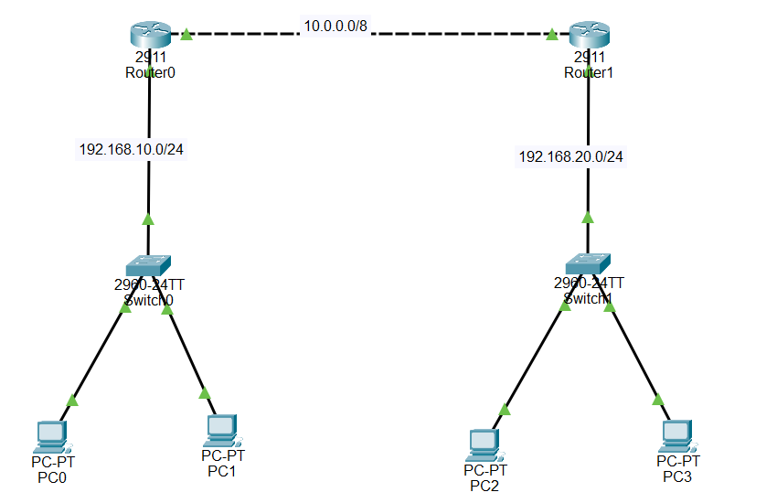

# Dynamic NAT Configuration

**CCNA 200-301 Domain:** 4.0 IP Services (4.1 Configure and verify inside source NAT using static and pools)
**Tool:** Cisco Packet Tracer · **Completed:** July 9, 2026

## Objective

Translate a whole private LAN to public addresses taken from a pool, instead of mapping each host by hand as in [Static NAT](../03-static-nat/). Hosts borrow a public address when they send traffic and return it when the translation expires.

## Topology



| Device | Interface | IP Address | NAT role |
| --- | --- | --- | --- |
| R1 (2911) | G0/0 | 192.168.10.1/24 | inside — LAN 1 (PC0, PC1) |
| R1 | G0/1 | 10.0.0.1/8 | outside — link to R2 |
| R2 (2911) | G0/1 | 10.0.0.2/8 | link to R1 (no NAT) |
| R2 | G0/0 | 192.168.20.1/24 | LAN 2 (PC2, PC3) |

Each LAN gets addresses from its router's DHCP pool (gateway .1 excluded). Only R1 performs NAT; R2 simply routes.

**NAT pool:** 10.0.0.20 – 10.0.0.25 (6 public addresses) for hosts in 192.168.10.0/24.

## Configuration

### R1

```
interface gigabitEthernet 0/0
 ip address 192.168.10.1 255.255.255.0
 ip nat inside
interface gigabitEthernet 0/1
 ip address 10.0.0.1 255.0.0.0
 ip nat outside
 exit
access-list 1 permit 192.168.10.0 0.0.0.255
ip nat pool 1 10.0.0.20 10.0.0.25 netmask 255.0.0.0
ip nat inside source list 1 pool 1
ip route 0.0.0.0 0.0.0.0 10.0.0.2
```

The three NAT lines work together:

1. **`access-list 1`** — *which* inside hosts may be translated (all of 192.168.10.0/24)
2. **`ip nat pool 1`** — *what* public addresses they may use (10.0.0.20–.25)
3. **`ip nat inside source list 1 pool 1`** — ties the two together

### R2

```
interface gigabitEthernet 0/0
 ip address 192.168.20.1 255.255.255.0
interface gigabitEthernet 0/1
 ip address 10.0.0.2 255.0.0.0
 exit
ip route 0.0.0.0 0.0.0.0 10.0.0.1
```

## Verification

`show ip nat translations` on R1 after pinging PC2 (192.168.20.2) from PC0 and then PC1:

```
Pro  Inside global     Inside local       Outside local      Outside global
icmp 10.0.0.20:1       192.168.10.2:1     192.168.20.2:1     192.168.20.2:1
icmp 10.0.0.20:2       192.168.10.2:2     192.168.20.2:2     192.168.20.2:2
...
icmp 10.0.0.20:8       192.168.10.2:8     192.168.20.2:8     192.168.20.2:8
icmp 10.0.0.21:10      192.168.10.3:10    192.168.20.2:10    192.168.20.2:10
icmp 10.0.0.21:11      192.168.10.3:11    192.168.20.2:11    192.168.20.2:11
icmp 10.0.0.21:12      192.168.10.3:12    192.168.20.2:12    192.168.20.2:12
```

PC0 (192.168.10.2) was given the first free pool address, **10.0.0.20**. When PC1 (192.168.10.3) sent traffic, it was given the next one, **10.0.0.21**. No host-by-host configuration was needed.

`show ip nat statistics` on R1 (taken after the earlier translations had timed out):

```
Total translations: 0 (0 static, 0 dynamic, 0 extended)
Outside Interfaces: GigabitEthernet0/1
Inside Interfaces: GigabitEthernet0/0
Hits: 0  Misses: 7
Expired translations: 3
Dynamic mappings:
-- Inside Source
access-list 1 pool 1 refCount 0
 pool 1: netmask 255.0.0.0
       start 10.0.0.20 end 10.0.0.25
       type generic, total addresses 6 , allocated 0 (0%), misses 0
```

This confirms the inside/outside interfaces, the ACL-to-pool binding, and the pool size (6 addresses). `Expired translations: 3` and `allocated 0` show that dynamic entries are temporary: once they time out, the addresses go back to the pool.

## Static vs Dynamic NAT

| | Static NAT | Dynamic NAT |
| --- | --- | --- |
| Mapping | One fixed private ↔ public pair per host | Any permitted host ↔ next free pool address |
| Configured per | Host | Subnet (ACL) + pool |
| Outside can start connections in | Yes | No — only while a translation exists |
| Limit | One public address per host | Pool size: 6 here, so a 7th simultaneous host gets no translation (a "miss") |

## Key Takeaways

- Dynamic NAT needs an **ACL** (who), a **pool** (what), and the **`ip nat inside source list … pool …`** command (link), plus the usual inside/outside interfaces.
- Addresses are handed out first come, first served, and returned when entries expire.
- The pool caps how many hosts can be translated at once. PAT (`overload`) removes that limit by sharing one address across many hosts using port numbers.
