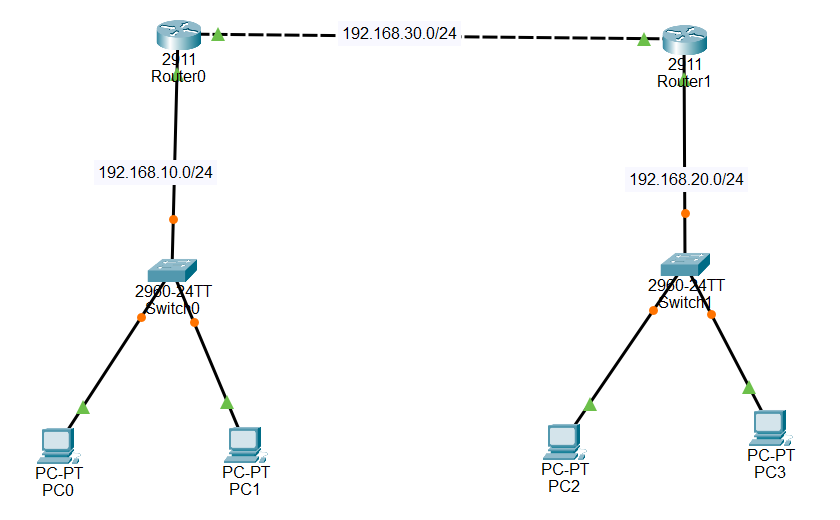

# PAT Configuration (NAT Overload)

**CCNA 200-301 Domain:** 4.0 IP Services (4.1 Configure and verify inside source NAT using static and pools)
**Tool:** Cisco Packet Tracer · **Completed:** July 9, 2026

## Objective

Let every host on a private LAN share a single public IP address by using Port Address Translation (PAT, also called NAT overload). This completes the NAT series after [Static NAT](../03-static-nat/) and [Dynamic NAT](../04-dynamic-nat/).

## Topology



| Device | Interface | IP Address | NAT role |
| --- | --- | --- | --- |
| R1 (2911) | G0/0 | 192.168.10.1/24 | inside — LAN 1 (PC0, PC1) |
| R1 | G0/1 | 192.168.30.1/24 | outside — link to R2 |
| R2 (2911) | G0/1 | 192.168.30.2/24 | link to R1 (no NAT) |
| R2 | G0/0 | 192.168.20.1/24 | LAN 2 (PC2, PC3) |

Each LAN gets addresses from its router's DHCP pool. Only R1 performs PAT; R2 simply routes.

**Public range:** pool 10.0.0.1 – 10.0.0.5 on R1. The 10.0.0.0 addresses don't exist on any interface. They work because R2's default route sends all unknown traffic, including replies to 10.0.0.x, back to R1, the same way an ISP routes a customer's public block to the customer's router.

## Configuration

### R1

```
interface gigabitEthernet 0/0
 ip address 192.168.10.1 255.255.255.0
 ip nat inside
interface gigabitEthernet 0/1
 ip address 192.168.30.1 255.255.255.0
 ip nat outside
 exit
access-list 1 permit 192.168.10.0 0.0.0.255
ip nat pool 1 10.0.0.1 10.0.0.5 netmask 255.0.0.0
ip nat inside source list 1 pool 1 overload
ip route 0.0.0.0 0.0.0.0 192.168.30.2
```

The only difference from Dynamic NAT is the **`overload`** keyword. Without it, each host takes a whole pool address; with it, hosts share an address and are told apart by port number.

### R2

```
interface gigabitEthernet 0/0
 ip address 192.168.20.1 255.255.255.0
interface gigabitEthernet 0/1
 ip address 192.168.30.2 255.255.255.0
 exit
ip route 0.0.0.0 0.0.0.0 192.168.30.1
```

## Verification

`show ip nat translations` on R1 after pinging PC2 (192.168.20.2) from PC0 and PC1:

```
Pro  Inside global     Inside local       Outside local      Outside global
icmp 10.0.0.1:1        192.168.10.2:1     192.168.20.2:1     192.168.20.2:1
icmp 10.0.0.1:2        192.168.10.2:2     192.168.20.2:2     192.168.20.2:2
icmp 10.0.0.1:3        192.168.10.2:3     192.168.20.2:3     192.168.20.2:3
icmp 10.0.0.1:4        192.168.10.2:4     192.168.20.2:4     192.168.20.2:4
icmp 10.0.0.1:5        192.168.10.3:5     192.168.20.2:5     192.168.20.2:5
...
icmp 10.0.0.1:12       192.168.10.3:12    192.168.20.2:12    192.168.20.2:12
```

PC0 (192.168.10.2) and PC1 (192.168.10.3) both appear as **10.0.0.1**. What keeps their traffic apart is the number after the colon (for ICMP, the query ID; for TCP/UDP, the port number). That is the "port" in Port Address Translation.

`show ip nat statistics` on R1:

```
Total translations: 12 (0 static, 12 dynamic, 12 extended)
Outside Interfaces: GigabitEthernet0/1
Inside Interfaces: GigabitEthernet0/0
Hits: 4  Misses: 20
Expired translations: 0
Dynamic mappings:
-- Inside Source
access-list 1 pool 1 refCount 12
 pool 1: netmask 255.0.0.0
       start 10.0.0.1 end 10.0.0.5
       type generic, total addresses 5 , allocated 1 (20%), misses 0
```

- **12 extended** translations: entries that include port information, which is PAT's signature.
- **allocated 1 (20%)**: two hosts and 12 sessions used only **one** of the five pool addresses. With plain Dynamic NAT, two hosts would have used two.

## NAT Types Compared

| | Static NAT | Dynamic NAT | PAT (overload) |
| --- | --- | --- | --- |
| Mapping | 1 private ↔ 1 public, fixed | 1 private ↔ 1 public from a pool | Many private ↔ 1 public, by port |
| Key command | `ip nat inside source static` | `… list 1 pool 1` | `… list 1 pool 1 overload` |
| Public addresses needed | One per host | One per active host | One for roughly 65,000 sessions |
| Typical use | Servers reachable from outside | Rare today | Home and office internet access |

## Key Takeaways

- PAT is what almost every home and office router does: the whole LAN shares the ISP-assigned address.
- When only one public address is available, use the outside interface's own address instead of a pool:
  ```
  ip nat inside source list 1 interface gigabitEthernet 0/1 overload
  ```
- PAT only translates outgoing traffic. To let outside hosts reach an inside server, add a static NAT or port-forwarding entry.
- R2's DHCP pool has no `ip dhcp excluded-address 192.168.20.1`. Adding it keeps the gateway address out of the pool.
