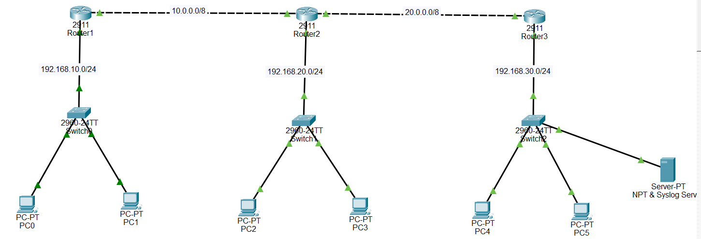

# NTP & Syslog Configuration

**CCNA 200-301 Domain:** 4.0 IP Services (4.2 Configure and verify NTP operating in a client and server mode; 4.5 Describe the use of syslog features including facilities and levels)
**Tool:** Cisco Packet Tracer · **Completed:** July 12, 2026

## Objective

Make three routers keep the same, correct time by syncing to a central NTP server, and send all of their log messages to a central syslog server on the same machine, so events from every device can be read in one place on one timeline.

## Topology



| Device | Interface | IP Address | Connects to |
| --- | --- | --- | --- |
| R1 (2911) | G0/0 | 192.168.10.1/24 | LAN 1 |
| R1 | G0/1 | 10.0.0.1/8 | R2 |
| R2 (2911) | G0/1 | 10.0.0.2/8 | R1 |
| R2 | G0/0 | 192.168.20.1/24 | LAN 2 |
| R2 | G0/2 | 20.0.0.1/8 | R3 |
| R3 (2911) | G0/1 | 20.0.0.2/8 | R2 |
| R3 | G0/0 | 192.168.30.1/24 | LAN 3, including **Server0 (192.168.30.4): NTP + syslog server** |

Each LAN gets addresses from its router's DHCP pool. The routers reach each other and the server through **EIGRP AS 1**.

## NTP Overview

- **Network Time Protocol** syncs device clocks to a reference time source over **UDP 123**
- A router configured with `ntp server` acts as an **NTP client**
- **Stratum** = distance from the reference clock: an atomic or GPS clock is stratum 0, a server synced to it is stratum 1, and so on
- Accurate time matters for log correlation, certificates (which have validity dates), and authentication protocols

## Syslog Overview

Syslog sends device event messages (interface up/down, errors, security events, configuration changes) to a central server over **UDP 514**, instead of only to the local console.

| Level | Keyword | Example |
| --- | --- | --- |
| 0 | Emergency | System unusable |
| 1 | Alert | Immediate action needed |
| 2 | Critical | Critical condition |
| 3 | Error | Error condition |
| 4 | Warning | Warning condition |
| 5 | Notification | Normal but significant (e.g. `%LINEPROTO-5-UPDOWN`) |
| 6 | Informational | Informational message |
| 7 | Debugging | Debug output |

`logging trap <level>` sends that level **and everything more severe** (lower numbers). `logging trap debugging` (7) sends every message.

A handy way to remember the order: **"Every Awesome Cisco Engineer Will Need Ice cream Daily."**

## Configuration

Identical on R1, R2 and R3:

```
ntp server 192.168.30.4
ntp update-calendar
logging 192.168.30.4
logging trap debugging
service timestamps log datetime msec
```

| Command | Purpose |
| --- | --- |
| `ntp server 192.168.30.4` | sync the router's clock to Server0 |
| `ntp update-calendar` | also write NTP time to the hardware calendar, so it survives a reload |
| `logging 192.168.30.4` | send log messages to the syslog server |
| `logging trap debugging` | send all severity levels (0–7) |
| `service timestamps log datetime msec` | stamp each log message with date and time to the millisecond |

Server0: **Services → NTP: On** and **Services → SYSLOG: On**.

### Routing (EIGRP AS 1)

```
R1: network 192.168.10.0
    network 10.0.0.0 0.0.0.255
R2: network 10.0.0.0 0.0.0.255
    network 192.168.20.0
    network 20.0.0.0 0.0.0.255
R3: network 20.0.0.0 0.0.0.255
    network 192.168.30.0
```

## Verification

- `show clock`: time and date, which should match the NTP server
- `show ntp status`: "Clock is synchronized", the stratum, and the reference (192.168.30.4)
- `show ntp associations`: the server, with `*` marking the peer the router is synced to
- `show logging`: logging state, trap level and the syslog host
- **Server0 → Services → SYSLOG**: messages arriving from the routers. **Confirmed:** log messages generated on the routers appear on the syslog server as well as on the local console.

### `show logging` on R1 (key lines)

```
Syslog logging: enabled (0 messages dropped, 0 messages rate-limited, ...)
    Console logging: level debugging, 11 messages logged
    Trap logging: level debugging, 11 message lines logged
        Logging to 192.168.30.4  (udp port 514,  audit disabled,
             authentication disabled, encryption disabled, link up),
             11 message lines logged,
             0 message lines dropped-by-MD
```

- **Trap logging: level debugging**: all severities 0–7 are sent to the server
- **Logging to 192.168.30.4 (udp port 514 … link up)**: the syslog host is configured and reachable
- **11 message lines logged** to the host, matching the 11 logged to the console: nothing was lost on the way

The log buffer starts with `%SYS-6-LOGGINGHOST_STARTSTOP: Logging to host 192.168.30.4 port 514 started - CLI initiated`, the router's own record of the moment `logging 192.168.30.4` was entered.

### Sample log output (R2)

```
*Jul 13, 23:06:57.066: %DUAL-5-NBRCHANGE: IP-EIGRP 1: Neighbor 10.0.0.1 (GigabitEthernet0/1) is down: holding time expired
*Jul 13, 23:06:57.066: %DUAL-5-NBRCHANGE: IP-EIGRP 1: Neighbor 20.0.0.2 (GigabitEthernet0/2) is down: holding time expired
*Jul 13, 23:06:57.066: %DUAL-5-NBRCHANGE: IP-EIGRP 1: Neighbor 10.0.0.1 (GigabitEthernet0/1) is up: new adjacency
*Jul 13, 23:06:57.066: %DUAL-5-NBRCHANGE: IP-EIGRP 1: Neighbor 20.0.0.2 (GigabitEthernet0/2) is up: new adjacency
*Jul 13, 23:06:57.066: %DUAL-5-NBRCHANGE: IP-EIGRP 1: Neighbor 10.0.0.1 (GigabitEthernet0/1) is down: Interface Goodbye received
*Jul 13, 23:06:57.066: %DUAL-5-NBRCHANGE: IP-EIGRP 1: Neighbor 20.0.0.2 (GigabitEthernet0/2) is down: Interface Goodbye received
*Jul 13, 23:06:57.066: %DUAL-5-NBRCHANGE: IP-EIGRP 1: Neighbor 10.0.0.1 (GigabitEthernet0/1) is up: new adjacency
*Jul 13, 23:06:57.066: %DUAL-5-NBRCHANGE: IP-EIGRP 1: Neighbor 20.0.0.2 (GigabitEthernet0/2) is up: new adjacency
```

Reading one message:

| Part | Meaning |
| --- | --- |
| `*Jul 13, 23:06:57.066` | timestamp from `service timestamps log datetime msec` |
| `%DUAL` | facility: EIGRP's DUAL algorithm |
| `5` | severity: **Notification** |
| `NBRCHANGE` | mnemonic: a neighbor changed state |
| rest | description: which neighbor, which interface, and why |

**The leading `*` matters.** In IOS, an asterisk before the timestamp means the router's clock is **not synchronized** (a `.` means it was synced but has lost sync). These messages were logged before R2 had synced with the NTP server. That's common right after startup, because NTP can take a few minutes to lock on. Once `show ntp status` reports "Clock is synchronized", new messages appear without the `*`.

**The EIGRP messages themselves** show R2's neighbors R1 (10.0.0.1) and R3 (20.0.0.2) dropping and re-forming adjacencies, all at the same millisecond. That is the pattern of the routers starting up together when the lab loads. "Interface Goodbye received" means the neighbor's EIGRP process restarted and announced it. Repeated flapping in a running network would point to a link or configuration problem.

## Findings

- **No DHCP exclusions, and the syslog server caught it.** None of the pools exclude the gateway (.1), and R3's pool also covers Server0's static address (192.168.30.4). R1's own log shows the result:
  ```
  *Jul 12, 22:54:11.5454: DHCPD-4-PING_CONFLICT: DHCP address conflict:  server pinged 192.168.10.1.
  ```
  This is exactly what central logging is for: the warning (severity 4) was recorded on the syslog server too. It's the same issue as in the [Extended ACL lab](../../05-security-fundamentals/05-extended-acl/). Fix on R3, and exclude each gateway the same way on R1 and R2:
  ```
  ip dhcp excluded-address 192.168.30.1
  ip dhcp excluded-address 192.168.30.4
  ```

## Key Takeaways

- NTP and syslog work as a pair. Central logs are only useful when every device stamps messages with the same, correct time.
- `logging trap` sets the **lowest-priority** level sent; everything more severe is included.
- Debug-level (7) logging is useful in a lab but floods a log server in production. Levels 4–6 are typical.
- In production, add `ntp authenticate` with keys so devices only trust a known time source.
