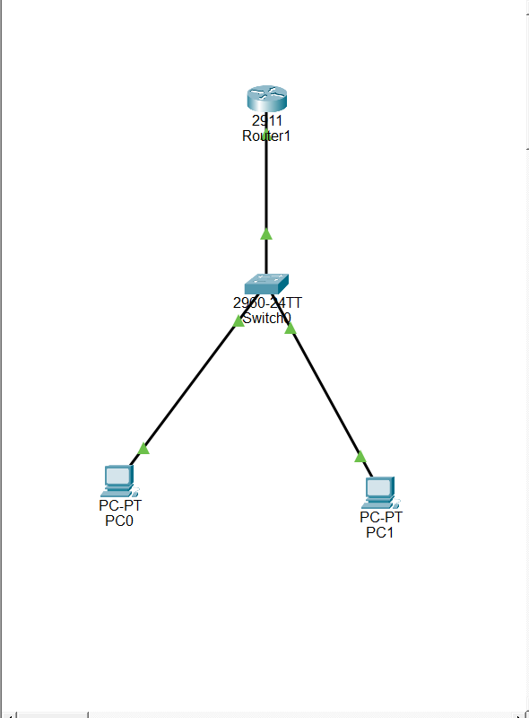

# Console, Enable & SSH Password Security

**CCNA 200-301 Domain:** 5.0 Security Fundamentals (5.3 Device access control using local passwords)
**Tool:** Cisco Packet Tracer · **Completed:** June 27, 2026

## Objective

Secure a Cisco router's management access: protect the console port, set a privileged EXEC password, encrypt passwords in the configuration, and allow remote access over SSH with local user accounts. The router also serves DHCP to the LAN.

## Topology



| Device | Model | Interface | IP Address | Notes |
| --- | --- | --- | --- | --- |
| R1 | Cisco 2911 (IOS 15.1) | G0/0 | 10.0.0.1/8 | Default gateway, DHCP server |
| Switch0 | Cisco 2960-24TT | — | — | Access switch |
| PC0, PC1 | PC-PT | NIC | DHCP | 10.0.0.0/8 pool |

## Configuration

### Base config and DHCP

```
enable
configure terminal
hostname r1
interface gigabitEthernet 0/0
 ip address 10.0.0.1 255.0.0.0
 no shutdown
 exit
ip dhcp pool r1
 network 10.0.0.0 255.0.0.0
 default-router 10.0.0.1
 exit
```

### SSH

```
ip domain-name cisco.com
crypto key generate rsa        ! 1024-bit modulus recommended
username user1 password cisco123
username user2 password cisco123
line vty 0
 transport input ssh
 login local
 exit
```

### Console, enable and encryption

```
line console 0
 password <password>
 login
 exit
enable password <password>
service password-encryption
```

## Verification

`show running-config` on R1 confirmed:

```
service password-encryption
hostname r1
enable password 7 0822455D0A16544541
ip dhcp pool r1
 network 10.0.0.0 255.0.0.0
 default-router 10.0.0.1
username user1 password 7 0822455D0A16544541
username user2 password 7 0822455D0A16544541
ip domain-name cisco.com
interface GigabitEthernet0/0
 ip address 10.0.0.1 255.0.0.0
line con 0
 password 7 0822455D0A16544541
 login
line vty 0
 login local
 transport input ssh
line vty 1 4
 login
```

PCs received addresses from the `r1` pool. SSH can be tested from a PC with `ssh -l user1 10.0.0.1`.

## Key Takeaways

- **Type 7 encryption is weak.** `service password-encryption` only hides passwords from casual viewing. The type 7 string above decodes to `cisco123` in seconds. Use `enable secret` (type 5/8/9 hash) instead of `enable password` in production.
- **Secure every VTY line.** Only `line vty 0` was set to SSH with local login. Lines 1–4 have `login` with no password, so they refuse connections. `line vty 0 4` (or `0 15`) applies one consistent policy.
- **Force SSH version 2** with `ip ssh version 2` after generating a key of at least 768 bits.

## Improvements

```
enable secret <strong-password>
ip ssh version 2
line vty 0 4
 transport input ssh
 login local
```
