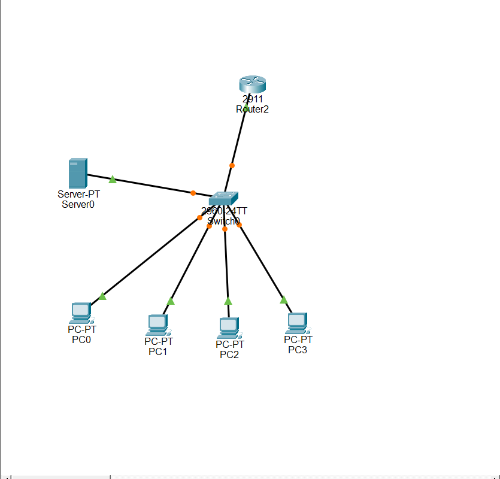

# SSH Remote Access on a Router

**CCNA 200-301 Objective:** 4.8 Configure network devices for remote access using SSH (grouped here with device security)
**Tool:** Cisco Packet Tracer · **Completed:** June 27, 2026

## Objective

Replace insecure remote management with SSH: generate RSA keys, create local user accounts, and restrict the router's VTY lines to SSH with local authentication. Then log in from a LAN host.

## Topology



| Device | Model | Interface | IP Address | Notes |
| --- | --- | --- | --- | --- |
| R1 | Cisco 2911 (IOS 15.1) | G0/0 | 192.168.10.1/28 | SSH server, default gateway |
| Server0 | Server-PT | NIC | 192.168.10.2/28 | — |
| Switch0 | Cisco 2960-24TT | — | — | Access switch |
| PC0–PC3 | PC-PT | NIC | 192.168.10.0/28 | SSH clients |

## Configuration

### On R1

```
enable
configure terminal
hostname R1
ip domain-name cisco.com
crypto key generate rsa        ! choose 1024 bits when prompted
username admin password admin1
username admin2 password admin2
line vty 0 1
 transport input ssh
 login local
 exit
do write
```

A hostname and domain name are both required before `crypto key generate rsa` will run — together they form the key's name (`R1.cisco.com`).

### On a client PC

**PC → Desktop → Command Prompt:**

```
ssh -l admin 192.168.10.1
```

## Verification

`show running-config` on R1:

```
hostname R1
username admin password 0 admin1
username admin2 password 0 admin2
ip domain-name cisco.com
interface GigabitEthernet0/0
 ip address 192.168.10.1 255.255.255.240
line vty 0 1
 login local
 transport input ssh
line vty 2 4
 login
```

Further checks on R1:

- `show ip ssh` — SSH enabled, version, key size
- `show ssh` — active SSH sessions and the user logged in

## Key Takeaways

- **No enable password = no privileged access remotely.** After logging in over SSH, `enable` fails with `% No password set` because none is configured. Over VTY, IOS requires an enable password or secret before allowing privileged EXEC mode. Fix: `enable secret <password>`.
- **Plain-text passwords.** `password 0` means the user passwords are stored in clear text. Use `username admin secret <password>` to store a hash instead.
- **Two SSH sessions maximum.** Only VTY 0–1 accept SSH. VTY 2–4 have `login` with no password, so they refuse every connection. Configuring `line vty 0 4` gives one consistent policy.
- **SSH version.** Add `ip ssh version 2` to disable the weaker SSHv1.

## Improvements

```
enable secret <strong-password>
username admin secret <strong-password>
ip ssh version 2
line vty 0 4
 transport input ssh
 login local
 exec-timeout 5 0
```
