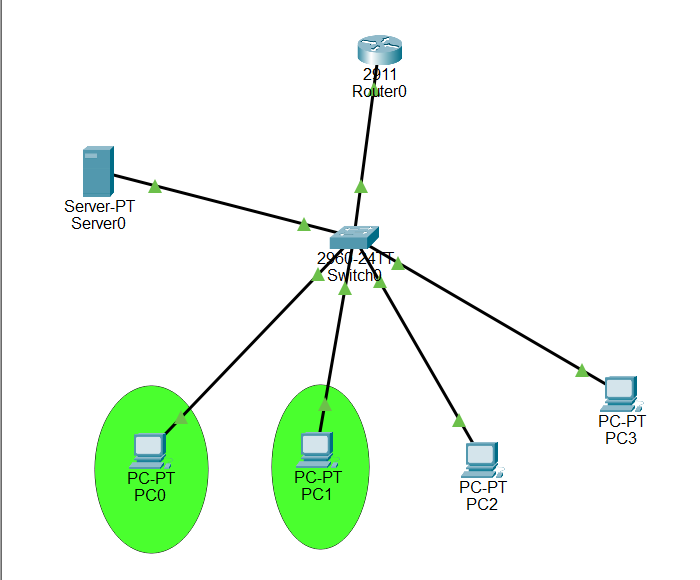

# Telnet Remote Access on a Router

**CCNA 200-301 Objective:** 4.8 Configure network devices for remote access (Telnet vs SSH) · grouped here with device security
**Tool:** Cisco Packet Tracer · **Completed:** June 28, 2026

## Objective

Enable remote, text-based management of a router over Telnet from LAN hosts, then compare it with SSH ([lab 02](../02-ssh-remote-access/)) to see why Telnet is considered insecure.

## Topology



| Device | Model | Interface | IP Address | Notes |
| --- | --- | --- | --- | --- |
| R1 | Cisco 2911 (IOS 15.1) | G0/0 | 192.168.10.1/28 | Telnet server, default gateway |
| Server0 | Server-PT | Fa0 | 192.168.10.2/28 | Gateway 192.168.10.1 |
| Switch0 | Cisco 2960-24TT | — | — | Access switch |
| PC0–PC3 | PC-PT | NIC | 192.168.10.0/28 | Telnet clients (PC0, PC1 highlighted) |

## Configuration

### On R1

```
enable
configure terminal
enable secret <password>
username ccna password ccna
line vty 0 1
 login local
 exit
```

`line vty 0 1` allows two simultaneous Telnet sessions, and `login local` makes each one authenticate against the router's local user accounts. `enable secret` is required so a remote user can enter privileged EXEC mode.

### On a client PC

**PC → Desktop → Command Prompt:**

```
telnet 192.168.10.1
```

## Verification

`show running-config` on R1:

```
hostname R1
enable secret 5 $1$mERr$Bok4KDfVutXOJolNq009M/
username ccna password 0 ccna
interface GigabitEthernet0/0
 ip address 192.168.10.1 255.255.255.240
line vty 0 1
 login local
line vty 2 4
 login
```

From a PC, `telnet 192.168.10.1` now prompts for the username and password before giving a CLI session.

`ipconfig` on Server0 confirms the LAN addressing: 192.168.10.2 / 255.255.255.240, gateway 192.168.10.1.

Further checks on R1: `show users` lists active VTY sessions and where they come from.

## Troubleshooting: From `no login` to `login local`

The first saved version of this lab had `no login` on VTY 0–1, so **no password was asked at all** — any host that could reach 192.168.10.1 got a CLI session. It was fixed by creating a local user and switching the lines to `login local`, so every session now needs a username and password.

Remaining hardening:

- `username ccna password 0 ccna` stores the password in clear text — use `username ccna secret <password>` for a hash.
- VTY 2–4 have `login` with no password, so they refuse connections. `line vty 0 4` with `login local` gives one consistent policy.

## Telnet vs SSH

| | Telnet | SSH |
| --- | --- | --- |
| Port | TCP 23 | TCP 22 |
| Encryption | None — usernames, passwords and commands travel in clear text | Encrypted session |
| Setup needed | VTY password + `login` | Hostname, domain name, RSA keys, local users |
| Use today | Labs and isolated networks only | Standard for device management |

Anyone capturing traffic on the LAN (for example with Wireshark) can read a Telnet password. Restricting the VTY lines with `transport input ssh` blocks Telnet entirely.

## Key Takeaways

- `login` tells the line to ask for a password; `no login` disables authentication completely.
- The number of VTY lines configured sets how many remote sessions can run at once.
- Telnet is fine for learning remote access, but production devices should allow SSH only.
