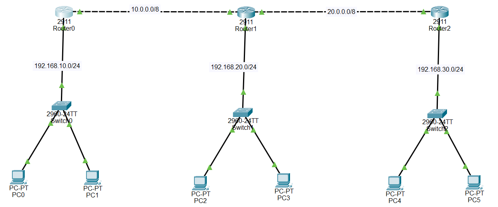

# Standard ACL Configuration

**CCNA 200-301 Domain:** 5.0 Security Fundamentals (5.6 Configure and verify access control lists)
**Tool:** Cisco Packet Tracer · **Completed:** July 11, 2026

## Objective

Use a numbered standard access control list to stop one host from sending traffic beyond its LAN, while every other host keeps full connectivity across a three-router network.

## Topology



| Device | Interface | IP Address | Connects to |
| --- | --- | --- | --- |
| R1 (2911) | G0/0 | 192.168.10.1/24 | LAN 1 — PC0, PC1 (**ACL 1 in**) |
| R1 | G0/1 | 10.0.0.1/8 | R2 |
| R2 (2911) | G0/1 | 10.0.0.2/8 | R1 |
| R2 | G0/0 | 192.168.20.1/24 | LAN 2 — PC2, PC3 |
| R2 | G0/2 | 20.0.0.1/8 | R3 |
| R3 (2911) | G0/1 | 20.0.0.2/8 | R2 |
| R3 | G0/0 | 192.168.30.1/24 | LAN 3 — PC4, PC5 |

Each LAN gets addresses from its router's DHCP pool (gateway .1 excluded).

**Routing:** R1 and R3 use default routes toward R2. R2 has static routes to the two outer LANs:

```
R1: ip route 0.0.0.0 0.0.0.0 10.0.0.2
R2: ip route 192.168.10.0 255.255.255.0 10.0.0.1
    ip route 192.168.30.0 255.255.255.0 20.0.0.2
R3: ip route 0.0.0.0 0.0.0.0 20.0.0.1
```

## Standard ACL Overview

- Filters on **source IP address only**: it cannot match destination, protocol or port
- Numbered **1–99** or **1300–1999** (expanded range), or named with `ip access-list standard NAME`
- Entries are checked top-down and the first match wins
- Every ACL ends with an invisible **implicit `deny any`**, so a list with only `deny` lines blocks everything

## Configuration

### R1

```
access-list 1 deny host 192.168.10.3
access-list 1 permit any
interface gigabitEthernet 0/0
 ip access-group 1 in
```

- **Line 1:** drop anything sourced from 192.168.10.3 (PC1)
- **Line 2:** allow everything else. Without it, the implicit deny would block the whole LAN.
- **`ip access-group 1 in`:** check packets as they **enter** R1 from LAN 1

Equivalent named version:

```
ip access-list standard BLOCK-PC1
 deny host 192.168.10.3
 permit any
interface gigabitEthernet 0/0
 ip access-group BLOCK-PC1 in
```

## Verification

- `show access-lists`: each entry with its match counter
- `show ip interface g0/0`: confirms "Inbound access list is 1"
- Ping from PC1 (192.168.10.3) to any remote LAN: expected to fail. R1 drops the packet and can return "Destination host unreachable" (ICMP administratively prohibited).
- Ping from PC0 (192.168.10.2) to the same host: expected to succeed

## ACL Placement

Cisco's guideline is to place **standard ACLs as close to the destination as possible**, because they can only see the source address. Placed near the source, the ACL blocks the host from *every* destination, not just the one you meant to protect.

In this lab the ACL sits inbound on PC1's own LAN, so PC1 is cut off from all three remote networks. That is correct if the goal is "PC1 may not leave its LAN". To block PC1 from **only LAN 3**, the same ACL would go **outbound on R3 G0/0**:

```
R3:
access-list 1 deny host 192.168.10.3
access-list 1 permit any
interface gigabitEthernet 0/0
 ip access-group 1 out
```

## Key Takeaways

- Standard ACLs match source addresses only, so placement decides what actually gets blocked.
- Always finish a deny list with `permit any` (or explicit permits), or the implicit deny drops everything.
- `in` filters traffic entering the interface; `out` filters traffic leaving it.
- Filtering on source, destination, protocol or port needs an **extended ACL**, which is the next lab.
