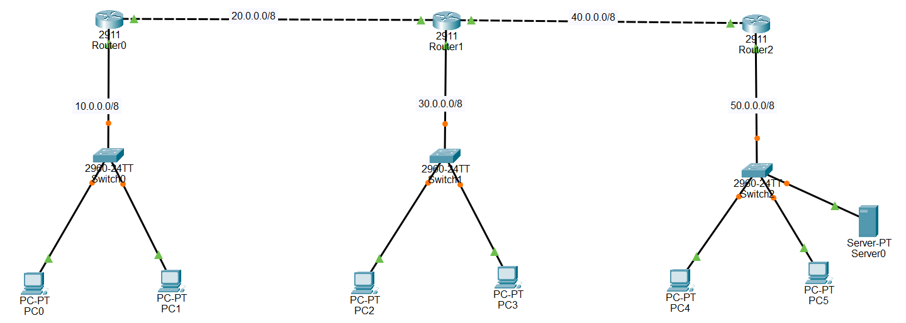

# Extended ACL Configuration

**CCNA 200-301 Domain:** 5.0 Security Fundamentals (5.6 Configure and verify access control lists)
**Tool:** Cisco Packet Tracer · **Completed:** July 12, 2026

## Objective

Use a numbered extended ACL to block a single service, web (HTTP), from one host to one server, while leaving all other traffic untouched. Unlike a [standard ACL](../04-standard-acl/), an extended ACL can match source, destination, protocol and port.

## Topology



| Device | Interface | IP Address | Connects to |
| --- | --- | --- | --- |
| R1 (2911) | G0/0 | 10.0.0.1/8 | LAN 1 — PC0, PC1 (**ACL 101 in**) |
| R1 | G0/1 | 20.0.0.1/8 | R2 |
| R2 (2911) | G0/1 | 20.0.0.2/8 | R1 |
| R2 | G0/0 | 30.0.0.1/8 | LAN 2 — PC2, PC3 |
| R2 | G0/2 | 40.0.0.1/8 | R3 |
| R3 (2911) | G0/1 | 40.0.0.2/8 | R2 |
| R3 | G0/0 | 50.0.0.1/8 | LAN 3 — PC4, PC5, Server0 (50.0.0.4, web server) |

Each LAN gets addresses from its router's DHCP pool, with the gateway address excluded (`ip dhcp excluded-address`).

**Routing:** R1 and R3 use default routes toward R2; R2 has static routes to the outer LANs.

```
R1: ip route 0.0.0.0 0.0.0.0 20.0.0.2
R2: ip route 10.0.0.0 255.0.0.0 20.0.0.1
    ip route 50.0.0.0 255.0.0.0 40.0.0.2
R3: ip route 0.0.0.0 0.0.0.0 40.0.0.1
```

## Extended ACL Overview

- Matches **protocol, source, destination and port**
- Numbered **100–199** or **2000–2699**, or named with `ip access-list extended NAME`
- Syntax: `access-list <num> permit|deny <protocol> <source> <destination> [eq <port>]`
- **Placement:** as close to the **source** as possible. Because the match is so specific, it can drop unwanted traffic early without affecting anything else.
- **`in`** filters packets as they enter the interface (before routing); **`out`** filters them as they leave (after routing)

## Configuration

### R1

```
access-list 101 deny tcp host 10.0.0.2 host 50.0.0.4 eq www
access-list 101 permit ip any any
interface gigabitEthernet 0/0
 ip access-group 101 in
```

| Part of line 1 | Meaning |
| --- | --- |
| `deny tcp` | drop TCP traffic |
| `host 10.0.0.2` | from this one host on LAN 1 |
| `host 50.0.0.4` | to Server0 on LAN 3 |
| `eq www` | only to port 80 (HTTP) |

Line 2 allows everything else. The ACL is applied inbound on R1's LAN interface, the closest point to the source.

## Troubleshooting: PCs Not Getting an IP Address

The first version of the ACL ended with **`permit tcp any any`** instead of `permit ip any any`:

```
access-list 101 deny tcp host 10.0.0.2 host 50.0.0.4 eq www
access-list 101 permit tcp any any
! (implicit) deny ip any any
```

**Symptom:** the PCs on LAN 1 could not get an address from R1's DHCP pool.

**Cause:** DHCP runs over **UDP** (client port 68 → server port 67). The ACL only permitted TCP, so every DHCP Discover fell through to the invisible **implicit `deny any`** at the end. Because the ACL is applied **inbound** on G0/0, it filters traffic addressed to the router itself as well, including requests for R1's own DHCP server. The same ACL would also have blocked ping (ICMP) and DNS (UDP 53).

**Fix:** permit all IP traffic in the last line:

```
no access-list 101
access-list 101 deny tcp host 10.0.0.2 host 50.0.0.4 eq www
access-list 101 permit ip any any
```

`permit ip any any` covers every protocol: TCP, UDP, ICMP and the rest.

## Troubleshooting: DHCP Address Conflict on R3

R3's console logged:

```
%DHCPD-4-PING_CONFLICT: DHCP address conflict:  server pinged 50.0.0.1.
```

**Cause:** R3's pool `r3` covers all of 50.0.0.0/8, including **50.0.0.1**, which is R3's own G0/0 address and the LAN's default gateway. Before leasing an address, the IOS DHCP server pings it. 50.0.0.1 answered, so R3 flagged a conflict and marked the address unusable.

**Fix:** exclude the gateway, and the statically addressed Server0, from the pool:

```
ip dhcp excluded-address 50.0.0.1
ip dhcp excluded-address 50.0.0.4
```

Each `excluded-address` line adds to the list. When the static devices sit next to each other, one range does the same job: `ip dhcp excluded-address 50.0.0.1 50.0.0.10`.

## Verification

- `show access-lists`: both entries, with match counters
- `show ip interface g0/0`: confirms "Inbound access list is 101"
- From the PC at 10.0.0.2, **Web Browser → http://50.0.0.4**: expected to time out (HTTP denied)
- From the same PC, `ping 50.0.0.4`: expected to succeed (ICMP is not blocked)
- From another LAN 1 PC, **Web Browser → http://50.0.0.4**: expected to load

## Key Takeaways

- Extended ACLs can block one service between two hosts and leave everything else alone. A standard ACL can't do that.
- `permit tcp any any` is **not** the same as `permit ip any any`. Leaving out UDP silently breaks DHCP, DNS and more.
- An inbound ACL also filters traffic destined to the router itself (DHCP, SSH, routing protocols), not just traffic passing through.
- The implicit deny at the end of every ACL is the usual cause of "everything stopped working".
- Exclude the gateway and any static devices from a DHCP pool, or the router's ping check reports address conflicts.
