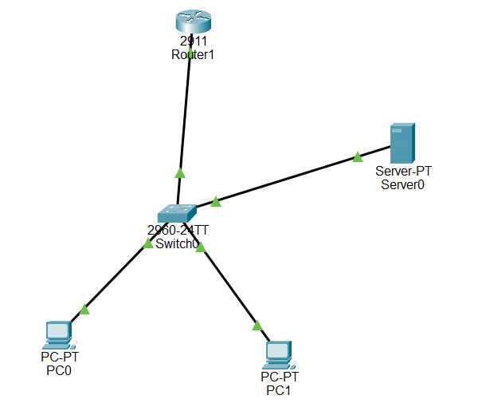
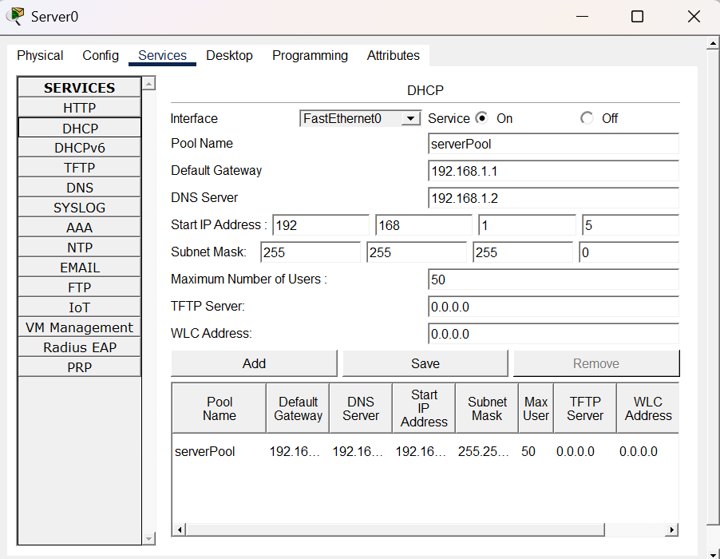
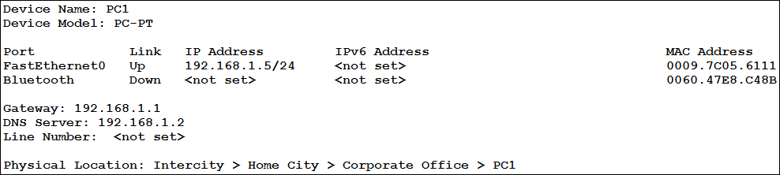

# DHCP Snooping

**CCNA 200-301 Domain:** 5.0 Security Fundamentals (5.7 Configure and verify Layer 2 security features: DHCP snooping, dynamic ARP inspection, and port security)
**Tool:** Cisco Packet Tracer · **Completed:** August 11, 2026

## Objective

Protect a LAN against rogue DHCP servers. The switch is set to trust DHCP server replies **only** on the port leading to the real DHCP server; replies arriving on any other port are dropped, so a personal router or misconfigured device plugged into an access port can't hand out bad addresses.

## Topology



| Device | Role | Address |
| --- | --- | --- |
| R1 (2911) | Default gateway, G0/0 | 192.168.1.1/24 |
| Server0 | The legitimate DHCP server, on switch port **Fa0/4** (trusted) | static |
| SW1 (2960, labelled Switch0) | DHCP snooping enabled on VLAN 1 | — |
| PC0, PC1 | DHCP clients on untrusted ports | DHCP |

R1 does not run DHCP: Server0 is the only legitimate DHCP server on the LAN.

### Server0 DHCP pool



| Setting | Value |
| --- | --- |
| Pool | serverPool |
| Default gateway | 192.168.1.1 |
| DNS server | 192.168.1.2 |
| Start address | 192.168.1.5 |
| Subnet mask | 255.255.255.0 |
| Max users | 50 (192.168.1.5 – 192.168.1.54) |

## Why DHCP Snooping

Without it, any device that answers DHCP requests first wins. A rogue server can give clients a wrong gateway or DNS server, sending their traffic through an attacker (**man-in-the-middle**), or simply break their connectivity. An attacker can also flood the real server with requests to use up its pool (**DHCP starvation**).

DHCP snooping classifies every switch port:

| Port type | Client messages (DISCOVER, REQUEST) | Server messages (OFFER, ACK) |
| --- | --- | --- |
| **Trusted** | Forwarded | Forwarded |
| **Untrusted** (default) | Forwarded, checked | **Dropped** |

The switch also builds a **binding table** (client MAC, leased IP, VLAN, port) from the leases it sees. Dynamic ARP Inspection and IP Source Guard use that table to stop spoofing.

## Configuration

### SW1

```
ip dhcp snooping
ip dhcp snooping vlan 1
interface fastEthernet 0/4
 ip dhcp snooping trust
```

| Command | Purpose |
| --- | --- |
| `ip dhcp snooping` | turn the feature on globally |
| `ip dhcp snooping vlan 1` | activate it for VLAN 1. Both commands are needed |
| `ip dhcp snooping trust` | mark Fa0/4, the port to Server0, as trusted. Every other port stays untrusted |

## Verification

PC1 received its address from Server0's pool through the snooping-enabled switch:



- **192.168.1.5/24**: the first address in `serverPool`
- **Gateway 192.168.1.1** and **DNS 192.168.1.2**: exactly the options configured on Server0

### Removing the trust

With `no ip dhcp snooping trust` on Fa0/4, the PCs **stop getting addresses**. Server0's OFFER and ACK now arrive on an untrusted port, so the switch drops them just as it would a rogue server's. This proves the switch is filtering by port, not by which server is "real".

Commands on SW1:

- `show ip dhcp snooping`: enabled VLANs and the trusted interfaces
- `show ip dhcp snooping binding`: each lease the switch has recorded (MAC, IP, VLAN, port)

## Key Takeaways

- Trust **only** the ports facing legitimate DHCP servers or uplinks toward them. Access ports stay untrusted.
- Snooping needs both the global command and the per-VLAN command. One without the other does nothing.
- The binding table is the foundation for **Dynamic ARP Inspection** and **IP Source Guard**.
- **Real-switch gotcha:** IOS switches add DHCP **option 82** to client requests when snooping is on, and a Cisco router acting as the DHCP server may drop those requests. If clients stop getting addresses after enabling snooping on real gear, `no ip dhcp snooping information option` is the usual fix.
- In production, add `ip dhcp snooping limit rate <pps>` on untrusted ports to slow down DHCP starvation attacks.
